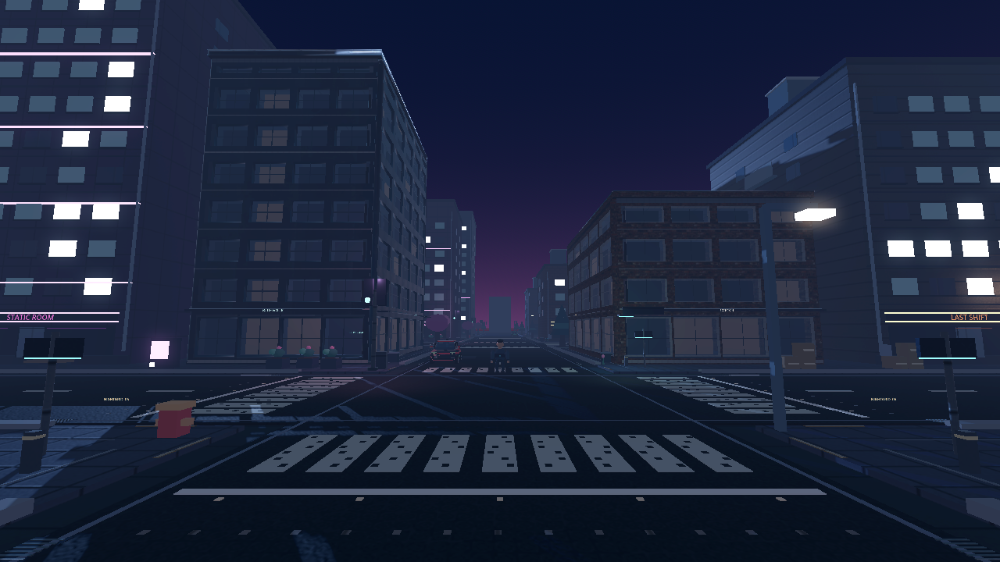
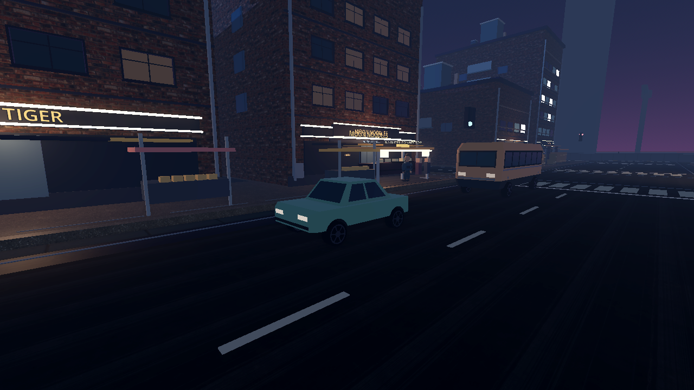

# NIGHTGRID: AFTERHOURS

**A cyberpunk open-world action sandbox set in the coastal city of Morrow Bay.**

Take courier jobs, drive through neon-lit streets, ride the city's buses and trains, explore cafés and nightclubs, and decide how to make your living after dark. The city keeps moving around you as daylight fades, businesses open and close, and police respond to reported incidents.

**Early playable beta — actively in development.**

[**Download for Windows**](https://github.com/ProhibitedTV/NightGrid-Afterhours/releases) · [Report a bug or suggest a feature](https://github.com/ProhibitedTV/NightGrid-Afterhours/issues) · [Playtest guide](docs/PLAYTEST_CHECKLIST.md)

*Central Exchange — real in-game rendering, not concept art.*

## Explore Morrow Bay

- Eight distinct neighborhoods, from the nightlife of Vesper Market to West Docks and the coastal North Quay.
- Drive cars or ride the M-Line train and city buses.
- Deliver packages, earn cash, take local jobs, visit shops, cafés, bars, clubs and public services.
- Explore furnished interiors, meet local characters and discover neighborhood stories.
- Experiment with arcade combat and a witness-based police wanted system.
- Experience a changing day/night cycle, working traffic signals, routine police patrols and dispatch communications.

Your city layout and progress persist when you save and return.

## In-game gallery

[**Browse the full 33-image gameplay gallery →**](docs/screenshots/GALLERY.md)

A quick look at Morrow Bay; the full gallery covers all eight neighborhoods, streets by day and night, storefronts, interiors, transit and gameplay views.

| Nightlife at Moon Noodles | M-Line elevated railway |
|:--:|:--:|
|  |  |
| **Horizon Gardens by day** | **Inside Quay Fresh** |
|  |  |
| **Title screen** | **City map** |
|  |  |

| **Redesigned Morrow Bay city bus** | **Original civilian sedan** |
|  |  |

These preview images are part of the 33-image Godot 4.7.2 viewport gallery from the development build. The two vehicle portraits stage real existing traffic actors on their route for an unobstructed comparison; they're not concept art or a driving benchmark. These development-build screenshots may be newer than the downloadable tagged beta. [Capture date/source, renderer and checksums](docs/screenshots/capture-manifest.json) · [Capture method](docs/screenshots/README.md). The gallery uses Linux software-rendered OpenGL; the Windows Forward+/Vulkan build may look different.

## Play the beta

1. Open [GitHub Releases](https://github.com/ProhibitedTV/NightGrid-Afterhours/releases) and download the Windows x64 beta ZIP, **not** the source code ZIP.
2. Extract the full archive into one folder and launch `NightGrid-Afterhours.exe`. Keep the EXE and PCK together.
3. Choose New World, then follow the amber pickup beacon and deliver the package to the cyan destination.

The beta is unsigned and may trigger Windows SmartScreen. Check the official release and its SHA256SUMS file before running.

### Quick controls

| Action | Keyboard / mouse |
|---|---|
| Move / look | WASD / mouse |
| Sprint / jump | Shift / Space |
| Enter or leave a car | E |
| Drive / brake | WASD / Space |
| Board or leave public transit | F |
| Enter or leave buildings | H |
| Interact with people and services | G |
| Map / journal / pause | M / Tab / Esc |
| Save / load | F5 / F9 |
| Equipment wheel | C |

Standard Xbox-style controller mappings are included. See the [full controls](docs/INPUT_MENUS.md) and in-game Controls menu.

## What's next

NightGrid is a rough but playable indie project. We're working toward richer street life, more detailed environments, dynamic traffic diversions, better animations and seamless movement through the city. The logical pedestrian and traffic foundations are in development; crowds and hybrid traffic streaming are not yet live gameplay.

The intended look is a realistic, atmospheric cyberpunk city, but visuals are still provisional. 1080p at 60 FPS on an RTX 3060 is a target, not a measured guarantee.

NightGrid FM uses original, creator-owned chipwave music. The music system is implemented, but the complete track pack is not currently included in the downloadable beta. See [soundtrack details](docs/NIGHTGRID_FM_SOUNDTRACK.md).

## For developers

Built with Godot **4.7.2** (Forward+/Vulkan). Clone the repository, open `project.godot` in the standard Godot editor and press F5 to run. For a locally voiced police radio build, install eSpeak NG and run `python3 tools/generate_mbpd_radio.py` before importing.

[Developer guide](docs/DEVELOPMENT.md) · [World bible](docs/WORLD_BIBLE.md) · [Development roadmap](https://github.com/ProhibitedTV/NightGrid-Afterhours/issues/75) · [Builds](https://github.com/ProhibitedTV/NightGrid-Afterhours/actions/workflows/windows-build.yml)

**Help shape Morrow Bay.** Tried the beta or came here from Substack? [Share a bug, visual critique or feature suggestion](https://github.com/ProhibitedTV/NightGrid-Afterhours/issues/new). Tell us what build you tried, what worked, what felt unrealistic, and what you'd most like improved. F7 marks an issue in your local playtest log, F8 records frame times, and F10 captures a real game screenshot. See the [reporting checklist](docs/PLAYTEST_CHECKLIST.md) for details.

The source has no general public license yet; individual third-party assets retain their documented licenses.
