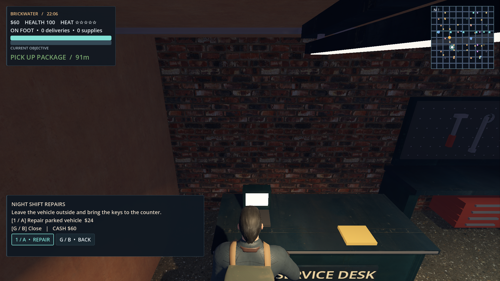
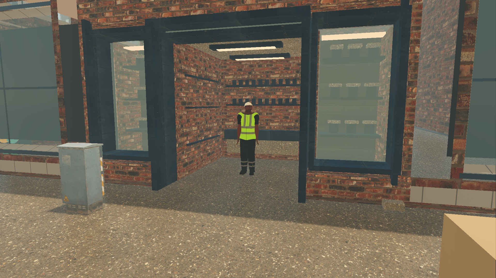

# NIGHTGRID: AFTERHOURS

**A neon-noir open-world game set in Morrow Bay, a restless coastal city.**

*Brickwater, 10:06 PM — captured in the actual Windows game.*

| Explore the city | Step inside |
|:--:|:--:|
|  |  |
| **Ride the M-Line** | **Meet the streets** |
|  |  |

*These are genuine 1080p Godot 4.7.2 Windows gameplay captures from the Beta.8 RC1 development candidate—not concept art or screenshots of the older published Beta.7.* [See the full gallery and capture details](docs/screenshots/beta8-rc1/GALLERY.md).

## Welcome to Morrow Bay

Take courier jobs, drive the city, ride trains and buses, enter shops, and explore districts that look and feel different after dark. NightGrid FM brings **20 original tracks** into the streets, cars, and venues. Traffic, police dispatch, and the changing light give the city its own rhythm.

We're building toward **one large, handcrafted city** with more believable architecture, working interiors, atmospheric weather, and life on every block.

**It's early and actively evolving.** You can play a Windows build now, but expect rough edges, unfinished systems, and experiments. Not every screenshot or feature above appears in the currently published release.

## Follow along or play

**[Download the Windows release](https://github.com/ProhibitedTV/NightGrid-Afterhours/releases)** · **[Explore the newest development builds](https://github.com/ProhibitedTV/NightGrid-Afterhours/actions/workflows/windows-build.yml)** · **[Share feedback and ideas](https://github.com/ProhibitedTV/NightGrid-Afterhours/issues)**

The tagged release is currently **Beta.7**. For newer in-development features, choose a successful `main` Windows build from GitHub Actions. Extract the full ZIP and keep the `.exe` and `.pck` together. [Playtest instructions](docs/PLAYTEST_MAIN_ACCEPTANCE.md).

## Help shape Afterhours

If you're interested in the project, follow development here, try a build, or tell us which places and features you'd like to explore. We're especially interested in how the world **looks, sounds, and feels** in motion.

Built with **Godot 4.7.2**. [Developer notes](docs/DEVELOPMENT.md) · [More screenshots](docs/screenshots/development/GALLERY.md) · [Project roadmap](https://github.com/ProhibitedTV/NightGrid-Afterhours/issues/197)

*The repository does not currently have a general public source license; third-party assets retain their documented licenses.*
