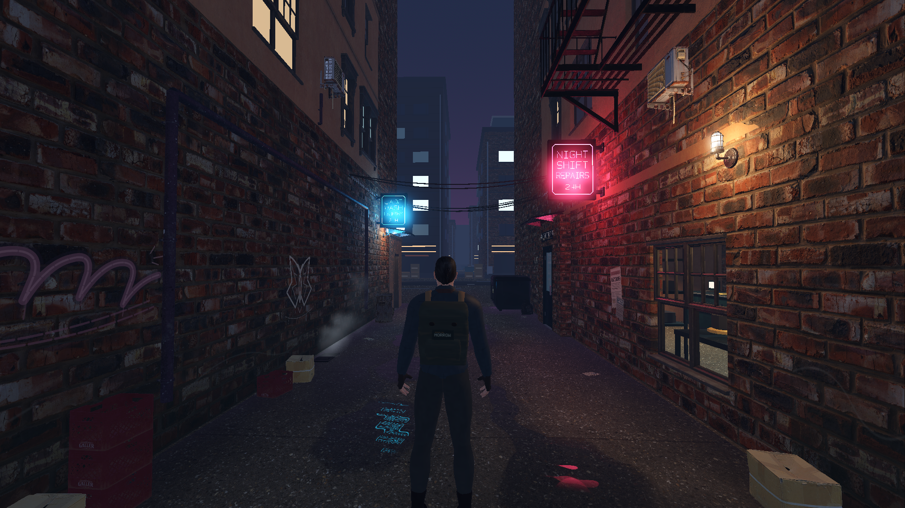
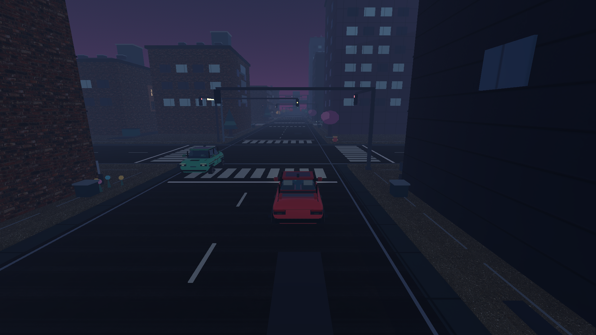
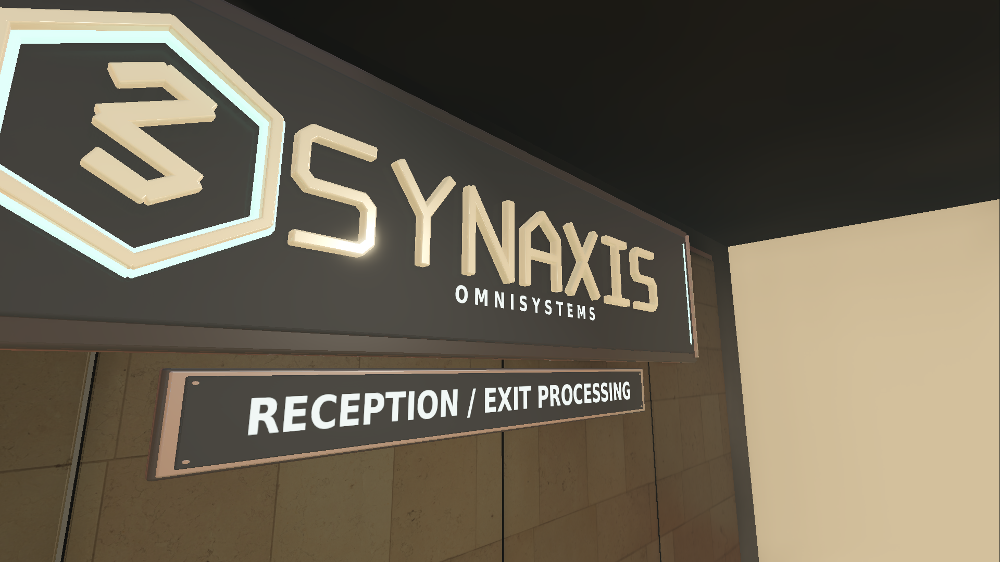
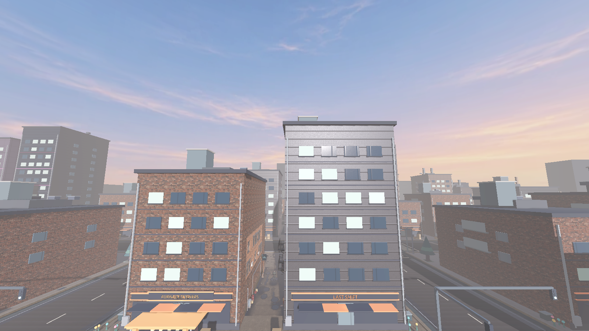
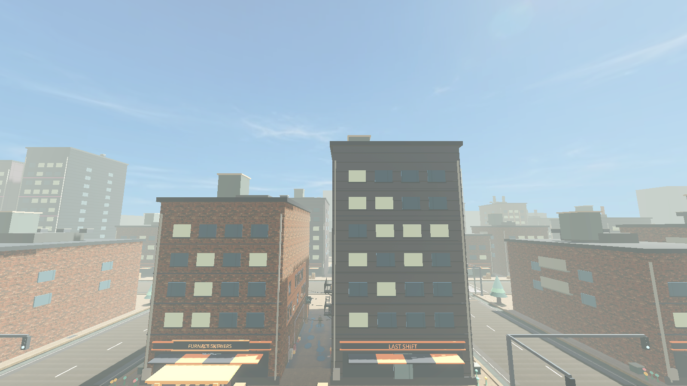
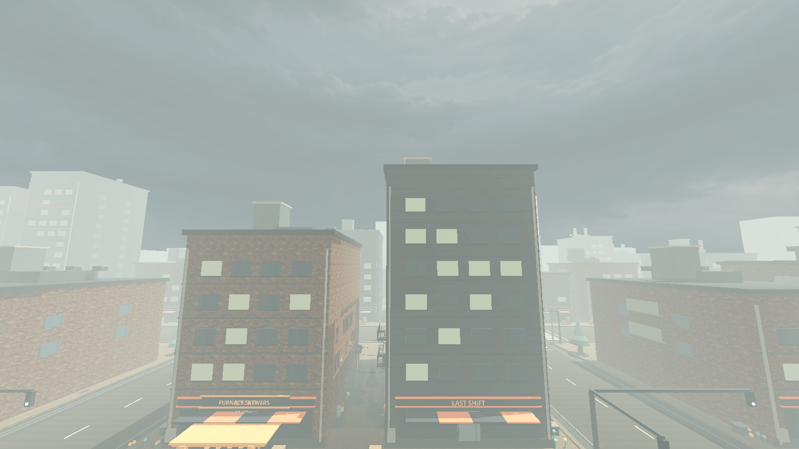

# NIGHTGRID: AFTERHOURS

**A neon-noir open-world game about starting over in Morrow Bay, a restless coastal city in 2036.**

Lose the corporate badge. Find a place to live. Make a living on your own terms.

[Download Beta.8 RC7 for Windows](https://github.com/ProhibitedTV/NightGrid-Afterhours/releases/tag/v0.1.0-beta.8-rc.7) · [Development builds](https://github.com/ProhibitedTV/NightGrid-Afterhours/actions/workflows/windows-build.yml) · [Report a bug / suggest a feature](https://github.com/ProhibitedTV/NightGrid-Afterhours/issues)

*Actual in-engine golden-hour capture, not concept art. The images on this page come from earlier development builds; they do not depict every feature now on main.*

## Welcome to Morrow Bay

The city is your playground, not just a delivery route. Begin as a corporate employee at Synaxis Omnisystems, navigate the office and discover the price of challenging its leadership. After losing your job, meet local contacts, earn money, rent a capsule, reclaim a vehicle, and decide what your life after Synaxis looks like.

Explore the waterfront, corporate Glassline, Brickwater's repair shops, the Vesper Market, the Afterhours nightlife district, public gardens and the Southworks streets. Find your own rhythm: independent work, cars, music, fashion, arcade games, investigation and neighborhood favors.

| Brickwater at night | A working repair shop |
|:--:|:--:|
|  |  |
| **East Gardens M-Line platform** | **Southworks driving** |
|  |  |

*Native Windows 1920×1080 Forward+/Vulkan captures from Beta.8 RC1, on an RTX 3060. [Capture provenance and full gallery](docs/screenshots/beta8-rc1/GALLERY.md).*

*Synaxis reception lighting in the Windows engineering build at `0a502df`. Captured from the exported game pack at 1920×1080 in Godot 4.7.2 Forward+/Vulkan on an RTX 3060. [Source revision](https://github.com/ProhibitedTV/NightGrid-Afterhours/commit/0a502dfdf430fece87e945c57553c5eed263dfe3).*

## What you can do on development main

The following systems are integrated as of **November 25, 2026 (Mountain Time)**. They are newer than the public release where noted; not all are final-quality content.

| Activity | Playable development features |
| --- | --- |
| **Chapter One — Executive Privilege** | Corporate arrival, Synaxis HQ, IT investigation, executive briefing, offboarding, severance and the transition to QuotaDrop. |
| **Independent work** | Decline or accept courier offers, go off duty, complete local and civic deliveries, diagnose equipment at Crane & Gear and Grid Annex Four, and follow The Paper City investigation. |
| **Home and personal economy** | Meet Mara at Lantern Cup, unlock the capsule, rest, store supplies, use the garage, recover a Kestrel S6, buy vehicle titles and manage cash and fictional BTC. |
| **Street music and bands** | Buy a PocketBeat M3, practice rhythm challenges, busk, perform at Blue Hour, recruit Rhea and Milo, rehearse, name your trio, play encores and a Static Room showcase, and press/sell cassette merchandise. |
| **INSERT COIN arcade** | Ten playable original cabinets, free practice, local rival scores, persistent personal bests, eight circuit stamps and three mastery tiers per game. |
| **Driving challenges** | Southworks Circuit and Brickwater Loop, ordered checkpoint navigation, personal records, replay and one-time completion prizes. |
| **Personal style** | Six clothing stores, separate garments and accessories, fitting previews, rotating Second Signal stock, USD/BTC purchase choices and three saved looks. |
| **Morrow OS smartphone** | Nine apps: QuotaDrop, Wallet, Contacts, Housing, Transit, Messages, Workboard, Music and Street cred. Navigate to real locations; purchases and work settlement happen in person. |
| **Street life and consequences** | Traffic signals, civic patrols, witness-dependent police heat, bounded pursuit, vehicle damage, market impacts, and an opt-in living-streets pedestrian pilot. |
| **Public transit and neighborhoods** | M-Line rail, elevators and buses, live station boards, public services, cafés, bars, shops and Horizon Commons garden furniture. |

### Earn your reputation

Your choices should create a life in the city rather than force a single career. Global Street Cred and the Music, Community and Underground scene profiles reflect actual completed activities, not passive waiting or purchases. Cash, ownership, activity receipts, arcade records and clothing choices are saved through the existing progression systems.

### INSERT COIN — games inside the game

The independent arcade celebrates players, small developers and good games while satirizing the fictional publishers that turned them into subscription machines.

| Cabinet | Play style |
| --- | --- |
| Grand Delay Auto VI | Driving and racing satire |
| Claw & Compliance | Lane-based brawler |
| Patch Day 2077 | Real-time bug repair |
| Indie Dev Simulator | Studio management |
| Annual Warfare 19 | Target gallery |
| Day-One DLC | Sliding puzzle |
| Open World Checklist | Map-icon routing |
| Battle Pass Hero | Timed command sequences |
| Starline Patrol | Space shooter |
| Neon Rebound | Paddle-and-ball challenge |

[Arcade design and implementation](docs/COIN_OP_ARCADE.md). The full illustrated cabinet art upgrade and native controller/visual acceptance are still work in progress.

### Drive, explore, listen

| Driving challenge | Gates | Limit | First completion |
| --- | ---: | ---: | ---: |
| Southworks Circuit | 8 | 90 seconds | $90 |
| Brickwater Loop | 9 | 120 seconds | $140 |

Find both on the phone's Workboard. Stop a roadworthy car at the start, use G (keyboard) or X (controller), follow the numbered rings and beat your own saved time. These are time trials, not yet full autonomous-opponent races.

Twenty original **NightGrid FM** tracks accompany the city, with vehicle radio, venue music, contextual ambience and independently adjustable audio settings. The offline Anubis studio is used for authored speech, sound effects and future reviewed performances, not real-time neural inference during gameplay.

## A city that changes after dark

| Dawn | Afternoon |
|:--:|:--:|
|  |  |
| **Moonlit night** | **Approaching storm** |
|  |  |

*Actual Godot 4.7.2 Linux/Mesa game captures from the same camera. Windows Vulkan rendering may differ.*

[Eight-sky gallery](docs/screenshots/skyboxes/GALLERY.md) · [Native development gallery](docs/screenshots/development/GALLERY.md) · [Brickwater architectural review](docs/screenshots/brickwater-review-archive/GALLERY.md)

## Download and playtest

**Public release:** [Beta.8 RC7 — Executive Privilege](https://github.com/ProhibitedTV/NightGrid-Afterhours/releases/tag/v0.1.0-beta.8-rc.7). Published November 25, 2026; includes the corporate opening. [Release notes](docs/BETA8_RC7.md).

**Latest development features:** choose a successful main-branch [Windows build](https://github.com/ProhibitedTV/NightGrid-Afterhours/actions/workflows/windows-build.yml) and download its `nightgrid-afterhours-windows-x64` artifact. GitHub may require login. Development builds are not public release candidates by default.

1. Extract the complete ZIP to a fresh directory. Keep the EXE and PCK together.
2. Check `BUILD-INFO.txt` for the exact source SHA and verify `SHA256SUMS.txt`.
3. Back up existing saves, then start a New World to experience Chapter One.
4. Follow the [integrated native playtest tracker](https://github.com/ProhibitedTV/NightGrid-Afterhours/issues/362) and [playtest instructions](docs/PLAYTEST_MAIN_ACCEPTANCE.md).

| Keyboard | Action |
| --- | --- |
| WASD / mouse | Move, drive and look |
| E | Enter / exit vehicle |
| G | Interact, collect / hand off, start a circuit |
| H | Interior / door |
| F | Transit |
| P / M / Tab | Smartphone / map / journal |
| Esc | Pause |
| B / N in car | Radio toggle / next track |
| F7 / F8 / F10 | Diagnostic marker / frame trace / screenshot |

Controller input is supported; native controller feel is still being validated. The street-crowd pilot is optional: run `NightGrid-Afterhours.exe -- --living-streets` in PowerShell from the extracted directory.

## Development status

**Engine:** Godot 4.7.2, Forward+ / Vulkan. **Target hardware:** Ryzen 7, RTX 3060 12 GB, 1080p at 60 FPS. This is a performance target, not a measured guarantee.

The last fully checked gameplay baseline documented here is [`72dd874`](https://github.com/ProhibitedTV/NightGrid-Afterhours/commit/72dd8740715dbbf5a9a08ee0e694f0b8c1e994c1): [full preflight](https://github.com/ProhibitedTV/NightGrid-Afterhours/actions/runs/45729614406) and [Windows export/startup](https://github.com/ProhibitedTV/NightGrid-Afterhours/actions/runs/45729614381) passed. Later commits must pass their own verification. Automated checks do not replace native art, audio, input or frame-pacing acceptance.

Current development priorities include competitive driving, repeatable freight and passenger jobs, deeper park activities, more physical clothing and music assets, pursuit/recovery consequences, streamed city fidelity and the next story chapters. Work under review is not part of main until merged: [active pull requests](https://github.com/ProhibitedTV/NightGrid-Afterhours/pulls).

The game is still in development: many models, performances, animations and systems are provisional. Full character voice coverage, complete campaign, physical race opponents, native performance acceptance and the expanded current-build screenshot gallery remain open.

## Project resources

- [Development guide](docs/DEVELOPMENT.md) · [City and districts](docs/CITY.md) · [World bible](docs/WORLD_BIBLE.md)
- [Beta 9 gameplay-depth milestone](https://github.com/ProhibitedTV/NightGrid-Afterhours/issues/273) · [Native playtest tracker](https://github.com/ProhibitedTV/NightGrid-Afterhours/issues/362)
- [Smartphone and music progression](docs/MORROW_PHONE_CORE.md) · [Fashion and character customization](docs/CHARACTER_CUSTOMIZATION.md) · [Garment authoring](docs/THREADLINE_ASSET_AUTHORING.md)
- [NightGrid FM soundtrack](docs/NIGHTGRID_FM_SOUNDTRACK.md) · [Unified Anubis audio production](docs/AUDIO_PRODUCTION_STUDIO.md) · [Offline SFX authoring](docs/SFX_AUTHORING.md)
- [Art direction](docs/APPROVED_WORLD_FIDELITY_TARGET.md) · [Streaming and frame pacing](docs/STREAMING_PERFORMANCE.md)

Help shape Afterhours: share screenshots, reproducible bugs, feedback, and ideas for life in Morrow Bay. Please include the source revision, graphics settings and relevant logs with playtest reports.

*This repository does not yet have a general public source license. Third-party assets retain their documented licenses; the original NightGrid FM soundtrack is creator-owned.*
