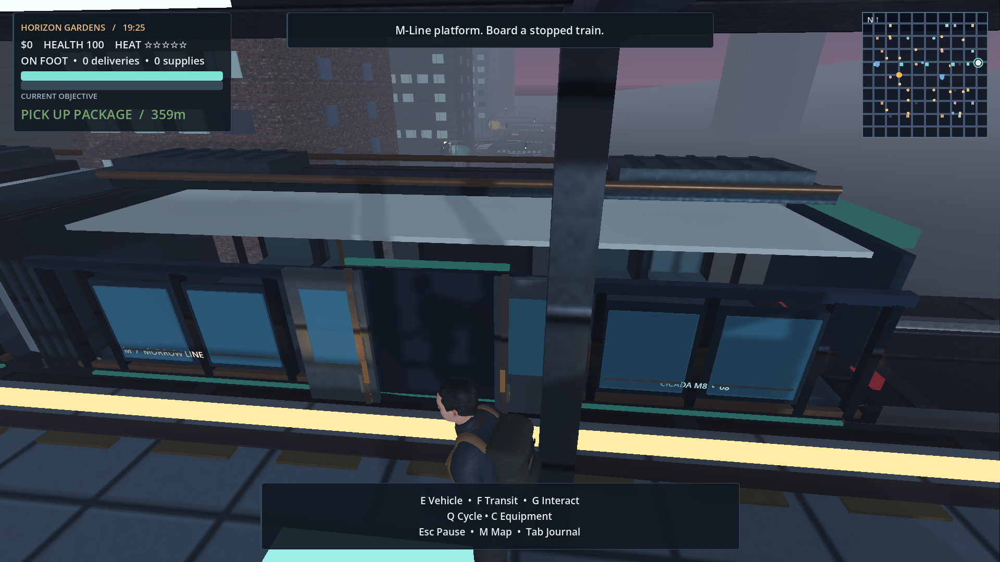
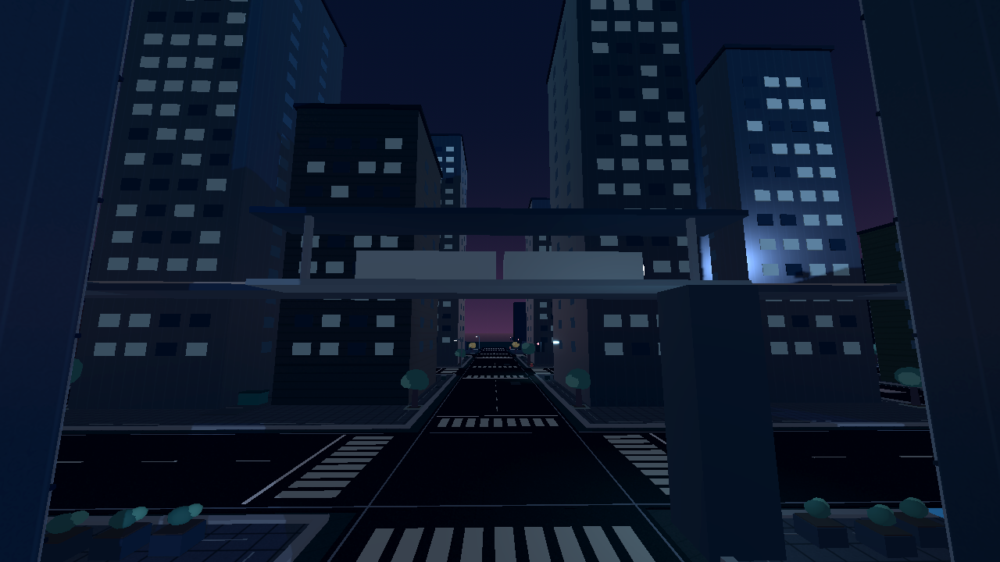
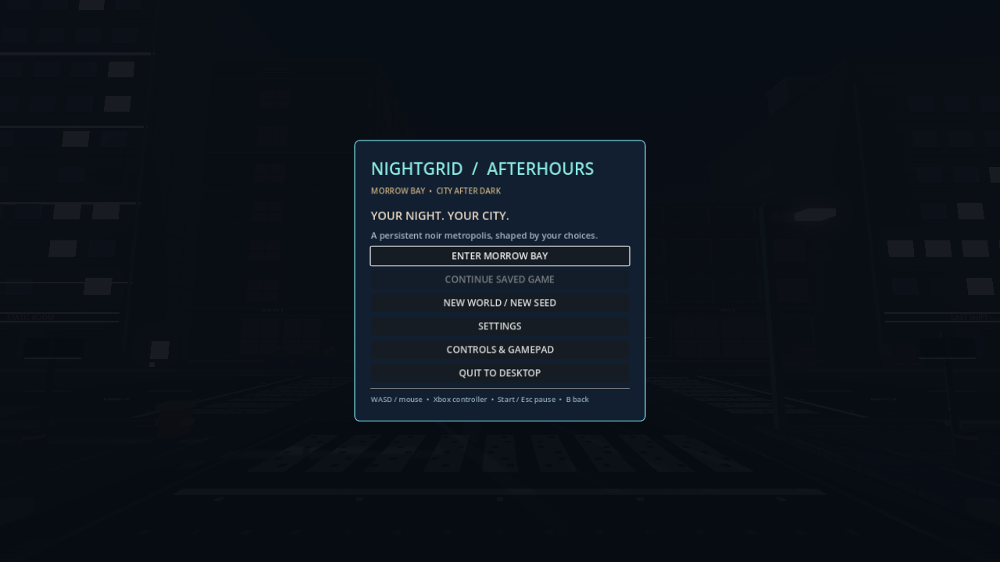
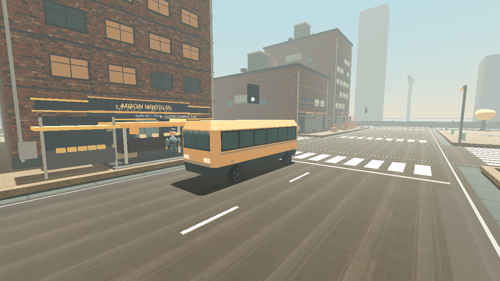
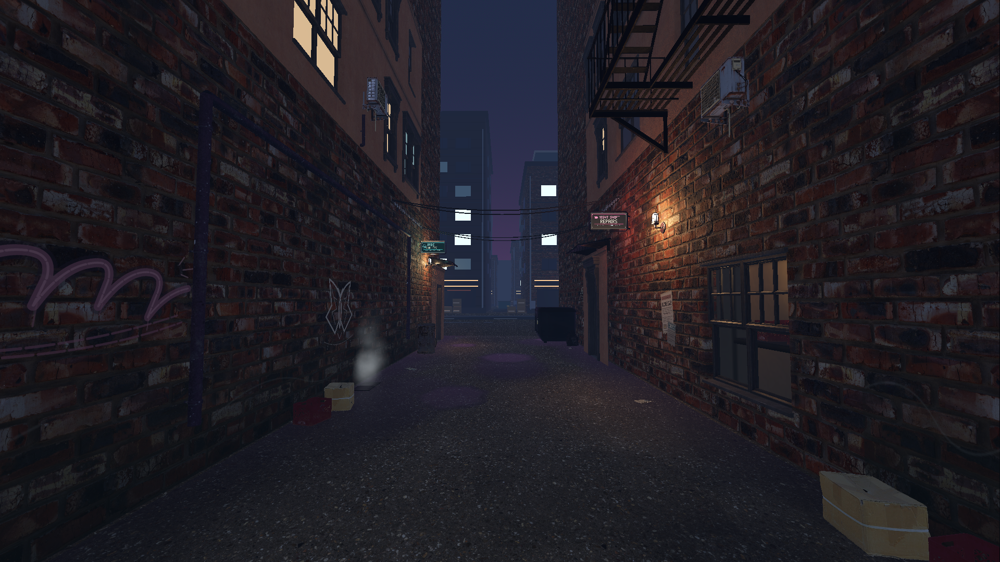
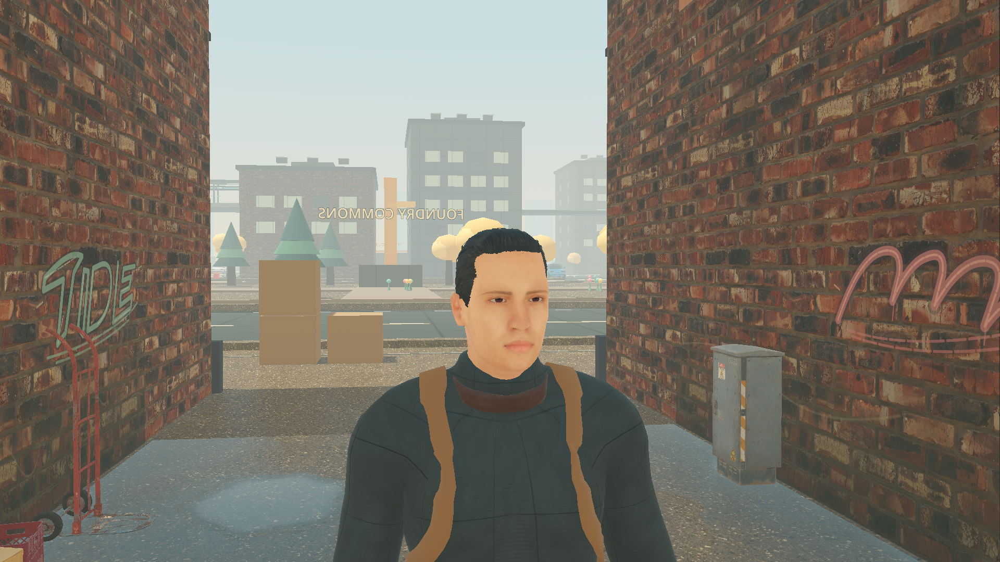
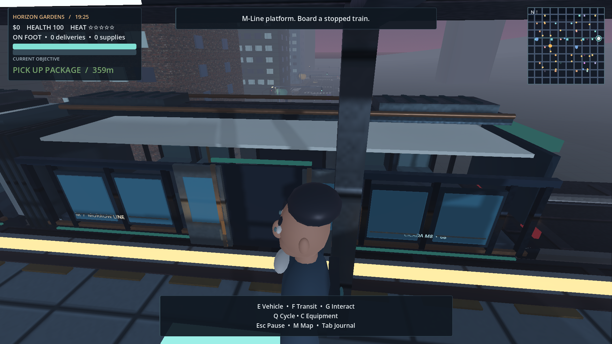

# NIGHTGRID: AFTERHOURS

**A cyberpunk open-world action sandbox set in the coastal city of Morrow Bay.**

Take courier jobs, drive through neon-lit streets, ride the city's buses and trains, explore cafés and nightclubs, and decide how to make your living after dark. The city keeps moving around you as daylight fades, businesses open and close, and police respond to reported incidents.

**Early playable beta — actively in development.**

**Beta.8 RC1 is available for Windows playtest review.** Walk Brickwater's neon service alley, get a car repaired at Night Shift Repairs, ride the M-Line and tune into the twenty original NightGrid FM tracks. Living Streets pedestrians and pooled traffic are optional pilots. [Review build and changelog](docs/BETA8_RC1.md) · [Candidate PR and Windows artifacts](https://github.com/ProhibitedTV/NightGrid-Afterhours/pull/196).

**[Follow the integrated-game Windows playtest and verification guide](docs/PLAYTEST_MAIN_ACCEPTANCE.md).** Check the artifact's `BUILD-INFO.txt` full source SHA and `SHA256SUMS.txt`, then run the EXE with its PCK. The [public beta.7 release](https://github.com/ProhibitedTV/NightGrid-Afterhours/releases/tag/v0.1.0-beta.7) is older and has not been replaced.

[**Download for Windows**](https://github.com/ProhibitedTV/NightGrid-Afterhours/releases) · [Report a bug or suggest a feature](https://github.com/ProhibitedTV/NightGrid-Afterhours/issues) · [Playtest guide](docs/PLAYTEST_CHECKLIST.md)

*Brickwater at 22:06, captured from the exported Windows candidate on Forward+/Vulkan.* [Beta.8 RC1 gameplay gallery](docs/screenshots/beta8-rc1/GALLERY.md) · [Build, renderer and capture provenance](docs/screenshots/beta8-rc1/provenance.json).

## Explore Morrow Bay

- Eight distinct neighborhoods, from the nightlife of Vesper Market to West Docks and the coastal North Quay.
- Drive cars or ride the M-Line train and city buses.
- Deliver packages, earn cash, take local jobs, visit shops, cafés, bars, clubs and public services.
- Explore furnished interiors, meet local characters and discover neighborhood stories.
- Experiment with arcade combat and a witness-based police wanted system.
- Experience a changing day/night cycle, working traffic signals, routine police patrols and dispatch communications.

Your city layout and progress persist when you save and return.

## Beta.8 RC1 in-game gallery

| Night Shift Repairs | East Gardens M-Line |
|:--:|:--:|
|  |  |
| **Southworks from the Kestrel** | **Living Streets pilot in Brickwater** |
|  |  |

## Earlier in-game gallery

| Nightlife at Moon Noodles | M-Line elevated railway |
|:--:|:--:|
|  |  |
| **Horizon Gardens by day** | **Inside Quay Fresh** |
|  |  |
| **Title screen** | **City map** |
|  |  |

| **Redesigned Morrow Bay city bus** | **Original civilian sedan** |
|  |  |

All nine images are actual Godot 4.7.2 viewport captures from the development build. The two vehicle portraits stage real existing traffic actors on their route for an unobstructed comparison; they're not concept art or a driving benchmark. These development-build screenshots may be newer than the downloadable tagged beta. [Capture date/source, renderer and checksums](docs/screenshots/capture-manifest.json) · [Capture method](docs/screenshots/README.md). The gallery uses Linux software-rendered OpenGL; the Windows Forward+/Vulkan build may look different.

## Selected native Windows development screenshots (feature-branch provenance)

These are **genuine Godot 4.7.2 Forward+/Vulkan captures at 1920×1080 on an RTX 3060**, taken on original feature branches that are now integrated through [PR #190](https://github.com/ProhibitedTV/NightGrid-Afterhours/pull/190). The individual frames are **not** a new full-stack main-branch visual approval or screenshots from beta.7; they do not establish sustained 60 FPS. Final integrated gameplay and artistic acceptance remains open.

[**See the 13-image development gallery**](docs/screenshots/development/GALLERY.md) · [Exact screenshot provenance](docs/screenshots/development/provenance.json)

| Brickwater night | New Morrow courier | East Gardens M-Line |
|:--:|:--:|:--:|
|  |  |  |

[Brickwater PR #163](https://github.com/ProhibitedTV/NightGrid-Afterhours/pull/163) · [Transport PR #165](https://github.com/ProhibitedTV/NightGrid-Afterhours/pull/165) · [Courier PR #166](https://github.com/ProhibitedTV/NightGrid-Afterhours/pull/166)

## Play the beta

1. Open [GitHub Releases](https://github.com/ProhibitedTV/NightGrid-Afterhours/releases) and download the Windows x64 beta ZIP, **not** the source code ZIP.
2. Extract the full archive into one folder and launch `NightGrid-Afterhours.exe`. Keep the EXE and PCK together.
3. Choose New World, then follow the amber pickup beacon and deliver the package to the cyan destination.

The beta is unsigned and may trigger Windows SmartScreen. Check the official release and its SHA256SUMS file before running.

### Quick controls

| Action | Keyboard / mouse |
|---|---|
| Move / look | WASD / mouse |
| Sprint / jump | Shift / Space |
| Enter or leave a car | E |
| Drive / brake | WASD / Space |
| Board or leave public transit | F |
| Enter or leave buildings | H |
| Interact with people and services | G |
| Map / journal / pause | M / Tab / Esc |
| Save / load | F5 / F9 |
| Equipment wheel | C |

Standard Xbox-style controller mappings are included. See the [full controls](docs/INPUT_MENUS.md) and in-game Controls menu.

## What's next

NightGrid is a rough but playable indie project. We're working toward richer street life, more detailed environments, dynamic traffic diversions, better animations and seamless movement through the city. The logical pedestrian and traffic foundations remain in development; the new 12-body Living Streets pilot is playable **only when opted in** and still requires material and live performance verification.

The merged development build now also has a bounded, **opt-in** Living Streets pilot (run the exported executable with `-- --living-streets`). The old beta.7 does not include this feature. The intended look is a realistic, atmospheric cyberpunk city; visuals are still provisional. 1080p at 60 FPS on an RTX 3060 is a target, not a measured guarantee.

The merged `main` **development build** includes all twenty creator-owned NightGrid FM chipwave tracks. The published beta.7 release predates this soundtrack update. [Soundtrack details](docs/NIGHTGRID_FM_SOUNDTRACK.md).

## For developers

Built with Godot **4.7.2** (Forward+/Vulkan). Clone the repository, open `project.godot` in the standard Godot editor and press F5 to run. For a locally voiced police radio build, install eSpeak NG and run `python3 tools/generate_mbpd_radio.py` before importing.

[Developer guide](docs/DEVELOPMENT.md) · [World bible](docs/WORLD_BIBLE.md) · [Development roadmap](https://github.com/ProhibitedTV/NightGrid-Afterhours/issues/75) · [Builds](https://github.com/ProhibitedTV/NightGrid-Afterhours/actions/workflows/windows-build.yml)

**Help shape Morrow Bay.** Tried the beta or came here from Substack? [Share a bug, visual critique or feature suggestion](https://github.com/ProhibitedTV/NightGrid-Afterhours/issues/new). Tell us what build you tried, what worked, what felt unrealistic, and what you'd most like improved. F7 marks an issue in your local playtest log, F8 records frame times, and F10 captures a real game screenshot. See the [reporting checklist](docs/PLAYTEST_CHECKLIST.md) for details.

The source has no general public license yet; individual third-party assets retain their documented licenses.
