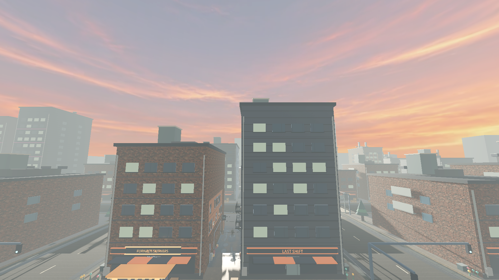
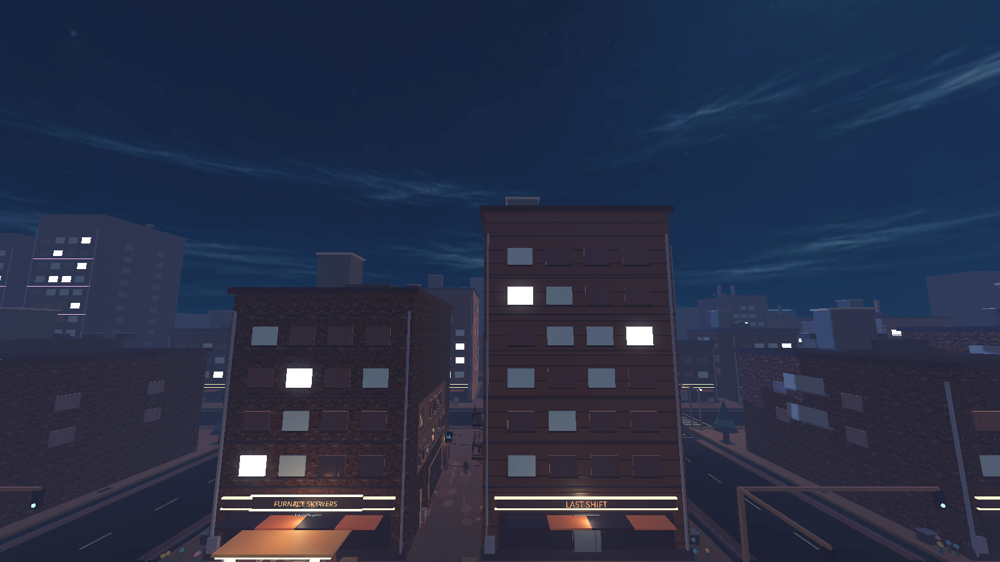

# NIGHTGRID: AFTERHOURS

**A neon-noir open-world game set in Morrow Bay, a restless coastal city.**

*Golden hour over Brickwater — an actual Godot game capture with our new original sky art.*

| Dawn over Brickwater | Sunny afternoon |
|:--:|:--:|
|  |  |
| **Moonlit night** | **Approaching storm** |
|  |  |

*These five images are **actual game screenshots**, not standalone sky paintings or concept art. All use the same camera in Brickwater to show the new sky and weather mood changes. [Explore all eight skies](docs/screenshots/skyboxes/GALLERY.md). The captures use Godot 4.7.2 with Linux Mesa rendering; Windows Vulkan appearance may differ.*

## Explore Morrow Bay

Take courier jobs, drive through neon-lit streets, ride the M-Line and city buses, step into local shops, and follow the rhythms of a city that changes after dark. Twenty original **NightGrid FM** tracks play across vehicles, venues and neighborhoods.

We're building **one large, handcrafted city**, with believable buildings and interiors, dynamic traffic and street life, cinematic lighting and weather. It is still early development, with plenty left to improve.

Want to see more than the skies? [Browse the Brickwater, vehicle and transit gameplay gallery](docs/screenshots/beta8-rc1/GALLERY.md).

## Play, follow and contribute

**[Windows download](https://github.com/ProhibitedTV/NightGrid-Afterhours/releases)** · **[Latest development builds](https://github.com/ProhibitedTV/NightGrid-Afterhours/actions/workflows/windows-build.yml)** · **[Feedback and ideas](https://github.com/ProhibitedTV/NightGrid-Afterhours/issues)**

The latest published candidate at this writing is **[Beta.8 RC3](https://github.com/ProhibitedTV/NightGrid-Afterhours/releases/tag/v0.1.0-beta.8-rc.3)**. The [releases page](https://github.com/ProhibitedTV/NightGrid-Afterhours/releases) lists newer candidates when published. The development branch now also includes a circular navigation radar, with a separate interactive atlas. For the newest development build, download a successful `main` build. Extract the full ZIP and keep the `.exe` alongside its `.pck`. [Playtest instructions](docs/PLAYTEST_MAIN_ACCEPTANCE.md).

**Help shape Afterhours.** If something looks exciting, unfinished or out of place, we'd like to hear about it. We welcome player feedback, screenshot comparisons, bug reports and ideas for life in Morrow Bay.

Made with **Godot 4.7.2**. [Developer notes](docs/DEVELOPMENT.md) · [Roadmap](https://github.com/ProhibitedTV/NightGrid-Afterhours/issues/197) · [More real game captures](docs/screenshots/development/GALLERY.md)

For contributors: [offline dialogue and sound effect production on Anubis](docs/AUDIO_PRODUCTION_STUDIO.md). Neural models are authoring tools only; the game uses reviewed baked assets and caption fallbacks. Current coverage is documented in the studio guide.

*This repository does not yet have a general public source license; third-party assets retain their documented licenses.*
