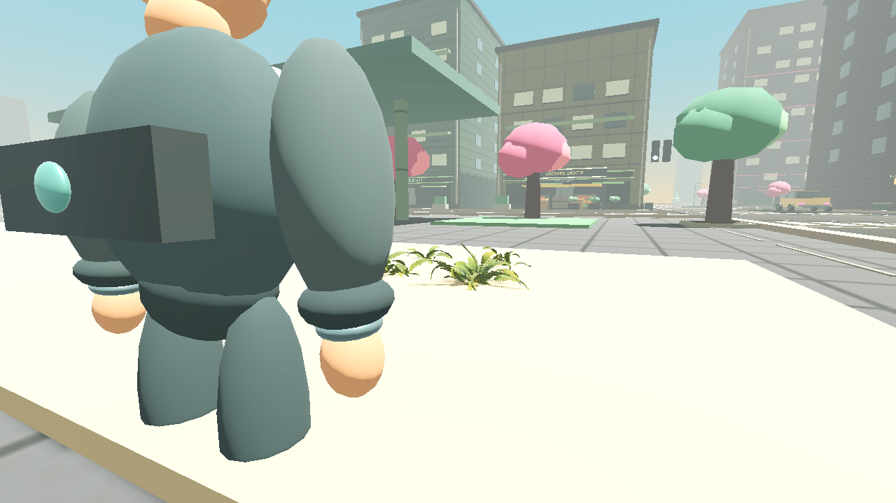
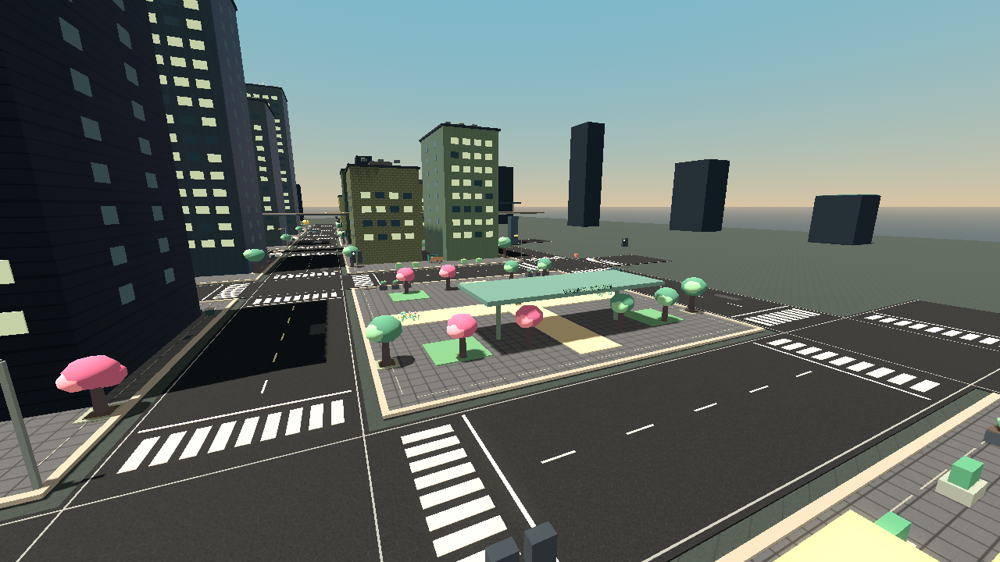
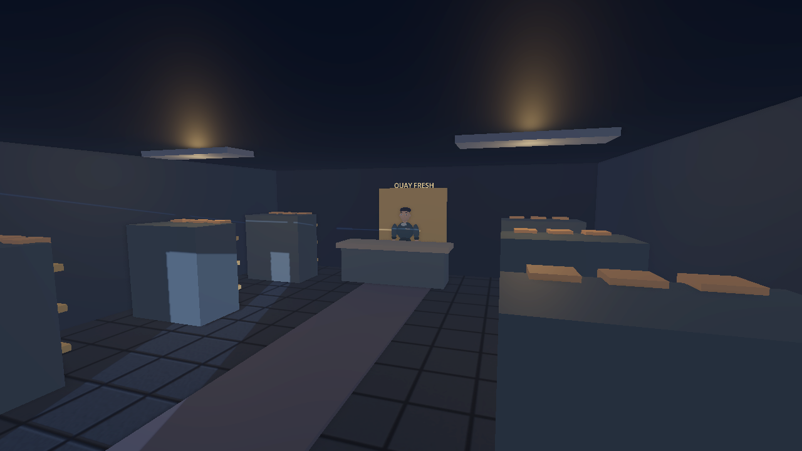

# NIGHTGRID: AFTERHOURS

**An original 3D, open-world night-courier and crime sandbox prototype.** A neon city, parked vehicles, delivery missions and basic police pursuit — no copied Rockstar assets.

### NightGrid FM — creator-owned chipwave soundtrack

A dedicated [NightGrid FM audio director](docs/NIGHTGRID_FM_SOUNDTRACK.md) now routes 20 original creator-supplied tracks into the title screen, in-car radio, interior cafés/bars/clubs and proximity-based exterior music at open venues. While driving, use **B** to toggle radio, **N** to skip (Xbox controller: D-pad Right / Up). There is a dedicated **music volume** control in Settings. Music crossfades between contexts while the existing environmental soundscapes continue.

**Audio asset note:** the source code and playlists live on this branch, but the 20 compressed Ogg recordings must also be installed under `assets/audio/nightgrid_fm/` before an export will actually contain music. The [guide](docs/NIGHTGRID_FM_SOUNDTRACK.md) explains the 50 MB creator-provided game-audio pack and checks. Builds without those files remain playable with procedural venue ambience, **but do not yet include the full audible soundtrack**.


### New Firebelley / Godot RenderingServer city-streaming pass

After the user's Vesper Market Filmic/ACES/AgX Windows beta.4 comparison, the [“Stop Using Nodes for Everything in Godot”](https://www.youtube.com/watch?v=1PnG3r1rKcs) video inspired a **real CPU/scene-graph improvement**: decorative MultiMesh groups now render through `RenderingServer` with **one RID lifetime owner per loaded city chunk**, rather than a separate `MultiMeshInstance3D` for every material bucket. Interactive signs, traffic, gameplay colliders and save data remain normal nodes. The **eight-light night pool** now aligns with actual emissive lamppost heads and storefront canopies, instead of arbitrary grid coordinates, addressing the beta.4 screenshot's dark sidewalks and toy-like detached glow. F7 and F10 capture batch and local-light counts for real Windows comparisons. **This work first ships in beta.5**; beta.4 remains the unoptimized Windows reference for paired frame-time comparisons. See [implementation / original sources / test gates](docs/RENDERING_SERVER_LIVE_CITY.md). Art quality remains provisional and 1080p/60 requires native testing.

### Exact Godot visual tutorial: reversible before/after experiment

The November 2026 [Coding Quests video “Why 3D Games Look Bad in Godot”](https://www.youtube.com/watch?v=0792U-wuwjA) demonstrates sky-driven shadow fill, side lighting, AgX tonemapping, occlusion, atmospheric fog, foliage shader normals and practical lighting **without changing the models**. **NightGrid beta.5 and development source use stable Godot 4.7.2** and offer a genuine **AgX** preview. Press **F11** to cycle **Filmic baseline → ACES + SKY → AgX + SKY → baseline**, taking real **F10** screenshots from an unchanged position and separate **F8** frame-time traces. Previous beta.3 remains a **Godot 4.3** build with Filmic/ACES only, useful for regression comparisons. AgX is an experiment, not an automatic improvement. [Technique comparison](docs/GODOT_VIDEO_REALISM_AB.md) · [4.7.2 migration details](docs/GODOT_4_7_2_MIGRATION.md).

### West Docks authored street architecture — original Crane & Gear production glTF

At permanent **West Docks (-4,-2), lot 1**, the previously opaque window-sticker warehouse is now replaced with an **actual original authored 3D building mesh**: six glTF material groups, 3,114 source triangles, 2 recessed industrial loading bays, 40 modeled windows with true reveals and room backing, complete rear/side walls, a 3D loading canopy and sloped roof/parapet. Nine optimized 1K PBR texture maps were derived from the bundled, verified **Poly Haven CC0 photographed brick, steel and bitumen** sources. The source glTF, geometric authoring recipe, source/model hashes and offline materials are committed, with no asset downloads in normal builds.

The original static parcel collision, civic addresses, existing rail/roads and saved city remain intact, with a dedicated source-geometry and deterministic-streaming CI regression. This is **one authored warehouse**, not a claim of complete AAA city realism or Windows 1080p/60 performance. Real F10 night/day frames and F8 on-device traversal metrics remain necessary for visual approval. [Original production mesh, license/source audit, exact footprint and playtest requirements](docs/CRANE_GEAR_ORIGINAL_GLTF_ART.md).

### Next West Docks art pass — original and CC0 rooftop servicing geometry

A further **West Docks service-roof pilot** now adds two actual 1K CC0 [Poly Haven Exterior Aircon Unit](https://polyhaven.com/a/exterior_aircon_unit) glTF models (clean and weathered original photo-PBR variants) to the existing `(-4,-1)` lot 1 warehouse. They sit on four original UV-mapped, genuinely extruded I-profile steel supports using already-licensed 2K photographed metal PBR. The source mesh and all texture/dependency bytes are pinned and hash-audited; the game never downloads art at runtime. No new physics colliders, lights, street placement changes or saved-world fields were introduced.

**This is a narrow in-game realism improvement, not AAA visual acceptance.** Use real Godot F10 frames at Dock Watch 22:07 and midday, plus F8 driving traces, to review rooftop silhouette, contact, shading and cost before expanding the street kit. See [full source provenance, original model geometry, and Windows review requirements](docs/WEST_DOCKS_ROOF_HVAC_ASSET_PASS.md).

### West Docks next art milestone — actual CC0 scanned glTF in the playable street

The existing Dock Watch Desk (-4,-1, lot 0) now has a **second fully modelled neighbor at (-4,-1, lot 1)**: an authored photo-PBR service-building envelope with UV-mapped brick and blue-steel façades, true upper-window reveals and backing, sealed photographed roof and two source-model service bays. The bays use the **real original 1K glTF meshes and textures** of [Poly Haven's CC0 Rollershutter Window 01](https://polyhaven.com/a/rollershutter_window_01), one weathered and one graffitied. Assets, source links and **per-file SHA-256 hashes are committed**; ordinary game builds have no downloads. This change retains both previous chunk colliders and Dock Watch's save-stable civic interaction.

**This is a technical art pilot, first downloadable in beta.6, not an approved photoreal scene**. Compare genuine Godot 4.7.2 Forward+/Vulkan F10 frames at West Docks 22:07 and daytime, plus F8 driving traces before accepting the art. [Source licenses, asset import and Windows visual acceptance checklist](docs/WEST_DOCKS_CC0_GLTF_ART.md).

### West Docks realism pilot from actual Windows beta feedback

The beta's first hands-on West Docks screenshot at **22:07** exposed repeating flat windows, opaque box-buildings and service facades that still read like blockout art. The permanent **Dock Watch Desk (-4,-1, lot 0)** now has a **narrow technical replacement**: scanned CC0 2K steel cladding and bitumen roof, true recessed glazing/window wall openings, backed room depth and a closed canopy/roof envelope. Existing collision, civic interaction, seed and saved-city layout remain fixed. **The rest of West Docks is not rebuilt** and this is **not yet a visually approved Windows/Forward+ result**. [Scope, evidence and actual screenshot acceptance requirements](docs/WEST_DOCKS_DOCK_WATCH_FIDELITY.md).

### First implemented step toward photorealistic city architecture

**Central Exchange (Brickwater/Afterhours corners):** two fixed building lots now have coherent custom `ArrayMesh` building façades, not the usual stacked `BoxMesh` window cards. Recessed windows, human-scale shop glazing, street-facing side elevations and canopy profiles are textured with **real 2K Poly Haven CC0 photographs** (brick and painted blue steel, each with albedo, OpenGL normal and roughness). Gameplay collision, street geometry, shop identities, save manifests and world seeds are preserved. This is a meaningful *partial world-engineering upgrade*, not a claim of AAA visual fidelity. [Full provenance, implementation, and actual Godot screenshot review](docs/CENTRAL_EXCHANGE_FIDELITY_PILOT.md). The rest of the city and original cars/characters are still visually provisional.

**Building-by-building art gate (2026-11-20):** The **Brickwater Central Exchange corner building, parcel `(-1,0)` lot `1`**, is the first independently reviewed complete-envelope pass: solid corner returns, masonry foundation, closed roof/parapet/copings, **photographed CC0 2K bitumen roof + brick/steel PBR** with tangent normals, and separate tinted glass/room backing. This is a **single-building geometry/material correction**, not a claim of finished AAA art or a new global building style. That first pass left the Afterhours neighbor unchanged. [See the building-specific geometry and Forward+ visual acceptance checklist](docs/BRICKWATER_CORNER_BUILDING_PASS.md).

**Building #2 — Afterhours corner (2026-11-20):** The matching **Afterhours Central Exchange building, parcel `(0,0)` lot `0`**, now has closed metal corner returns, continuous watertable, solid parapet/coping, genuine scanned **bitumen roofing** and steel facade, structural canopy edge seals, and glass with a separate recessed shaded room backing. This work stays within one known permanent address, retains gameplay collision and avoids adding per-frame geometry or lamps. It is **still a technical art pass**, not an artist-approved high-fidelity DCC/glTF asset. [Full building geometry/PBR QA and screenshot gates](docs/AFTERHOURS_CORNER_BUILDING_PASS.md).

### New approved visual direction: photorealistic cyberpunk city

**The target is the user-approved November 20, 2026 image of an ultrarealistic neon coastal metropolis—not the current low-poly, cartoonish or box-procedural style.** The reference depicts a realistic rain-wet waterfront boulevard, densely layered towers, elevated transport, detailed nightlife storefronts, premium cars and grounded city geometry. We will treat that image as a **future fidelity standard**; this prototype does *not* yet look like it. See the [approved world reference and acceptance criteria](docs/APPROVED_WORLD_FIDELITY_TARGET.md) before writing new geometry or claiming AAA progress. The updated genuine in-game screenshot gallery below shows the current pilot—including the Central Exchange PBR corners—but **does not meet the future photoreal target**.


### 60 FPS target with rendering independent of physics timing

**60 FPS at native 1080p is a quality target, not a measured achievement or an enforced cap.** Physics advances at a fixed **60 ticks/second**, but rendering remains **uncapped** (subject to the player's VSync preference). Train movement/station timing and gameplay mission, heat and damage timers run on physics ticks. The rail model receives separate 3D render interpolation compatible with Godot 4.3, and streaming focus plus HUD refresh are budgeted to 10 Hz rather than once per displayed frame. A regression test verifies transit logic remains identical with different render callback rates. [Engineering and acceptance protocol](docs/FRAME_PACING_AND_ASSETS.md).

**Asset policy:** prioritize original or licensed, UV-authored glTF assets and photographic PBR sets, with LODs/culling and real hardware profiling, over expanding procedural box geometry. The existing two CC0 Central Exchange facades are still an **incomplete architectural pilot**, not finished AAA quality.

### Single-plant realism pilot: Horizon Commons scanned fern

The first botanical art replacement is **one original source-authored four-clump Fern 02 (6,232 triangles)** in the permanent Horizon Commons garden bed. A real Poly Haven CC0 2K glTF, GL normal/packed ORM and separate source alpha mask replace a single old sphere/cone flower patch—**not** every tree in the city. A true RGBA cutout makes the serrated fronds visible without ugly rectangular cards. Godot uses UV/tangent-aware materials, anisotropic mipmaps and two-sided directional leaf shadows. No new physics, per-frame mesh generation or dynamic lights are involved. [The source/CC0 license and exact SHA-256 provenance](docs/HORIZON_FERN_ASSET_PASS.md) remain in the repository.



*Real in-game close-up captured in Godot's Mesa OpenGL Compatibility renderer; not concept art and not proof of 1080p60/Vulkan photorealism.* [Dusk inspection](docs/fern-review/horizon-fern-dusk-real-godot.png).

## Actual in-game screenshots


*Central Exchange at night — the actual Godot framebuffer showing the updated road-facing PBR facades, not a synthetic render.*

| Vesper Market / Moon Noodles | M-Line / Helix Terminal |
|:--:|:--:|
|  |  |
| **Horizon Commons — daytime** | **Quay Fresh — enterable interior** |
|  |  |
| **Main menu — title screen** | **City atlas — map screen** |
|  |  |

These seven images were **recaptured and committed by the real Godot screenshot workflow** on the AAA development branch. The [capture manifest](docs/screenshots/capture-manifest.json) records their source revision and SHA-256 checksums. Recapture proves provenance, not an automatic visual quality improvement. They are **real, unedited Godot 4.3 framebuffer captures**, not AI-generated artwork, concept mockups or marketing renders. The repeatable screenshot workflow ran the playable scene at **1280 × 720** on a Linux X11 virtual display using Mesa's software **OpenGL Compatibility renderer**. The downloadable Windows build defaults to **Forward+/Vulkan**, so its lighting and reflections can differ. [See how the captures were generated and verified.](docs/screenshots/README.md)


## First hands-on Windows playtest: stabilization and open visual debt

The first real Windows playtest **identified critical quality defects** that older headless CI could not catch: visible camera flythrough on club exits, camera clipping into buildings, detached generated storefront/building shells, rectangular character placeholders, awkward vehicle shapes and cartoonish city presentation. The camera, façade and placeholder-character code received a focused repair pass, explained in [the playtest triage report](docs/PLAYTEST_TRIAGE_2026_11_20.md). The quality issues **are not all resolved**: [art-direction reset #19](https://github.com/ProhibitedTV/NightGrid-Afterhours/issues/19), [vehicle rework #20](https://github.com/ProhibitedTV/NightGrid-Afterhours/issues/20), [city design #21](https://github.com/ProhibitedTV/NightGrid-Afterhours/issues/21).

**This is a rough playable prototype, not an AAA-quality asset release.** For the current version, download the latest *successful main-branch* Windows artifact, report real screenshots and FPS, and test H club exits and indoor save restore before evaluating visual polish. PR/CI passing is not equivalent to human visual acceptance.

## Windows beta 0.1.0-beta.6 — versioned, diagnostic-enabled download

The latest **tagged Windows x64 beta** is distributed through [GitHub Releases](https://github.com/ProhibitedTV/NightGrid-Afterhours/releases/tag/v0.1.0-beta.6) after its exact `main` commit passes the complete Godot 4.7.2 preflight. Download the `NightGrid-Afterhours-v0.1.0-beta.6-windows-x64.zip` asset (not GitHub's generic Source code ZIP). Extract both EXE and PCK together. Each package includes a version/commit manifest, playtest checklist and release notes; a separate `SHA256SUMS.txt` is available to verify the ZIP. The Windows executable remains **unsigned**; Chrome/SmartScreen may still flag it, and you should not disable browser protection globally. [Full release notes and honest limitations](docs/BETA_RELEASE_NOTES.md).

**Diagnostics included in the executable:** each play session writes its own version-stamped local JSONL log. Press **F7** to mark an issue and display its path, **F8** to record a frame-time CSV, and **F10** to capture real PNG+JSON evidence. Logs stay local, not in the downloaded ZIP. The beta does **not** include the uncommitted 20 Ogg soundtrack recordings or promise production-grade assets/performance.

## Play the first prototype

1. Download [Godot **4.7.2 stable**](https://godotengine.org/download/), standard version (no .NET), to open the current development source. The published beta.3 executable uses Godot 4.3.0.
2. Clone the repository, or select **Code → Download ZIP** on GitHub.
3. Open `project.godot` in Godot.
4. Press **F5** to play. Head for the amber pickup beacon; deliver the package to the cyan destination and earn money.

### Real menus and gamepad controls

The first Windows launch now opens an interactive **title screen** with Continue, New World, Settings, Controls and Quit. **Esc** or controller **Start** opens the pause menu, which freezes the world and provides Resume, Save, Load, New World confirmation, a full-size **City Map**, and an objective/inventory **Journal**. Settings persist in `user://settings.cfg` (volume, mouse/joystick sensitivity, Y inversion, reflections, bloom, contact shadows, atmospheric haze, VSync and FPS overlay). The stored world seed and building manifest remain separate from settings.

| Keyboard / mouse | Standard Xbox gamepad | Action |
|---|---|---|
| WASD + Mouse | Left / Right sticks | Walk and look |
| Shift / Space | L3 / A | Sprint or jump on foot |
| W/S, A/D, Space | RT/LT, left stick, B | Drive, steer, brake |
| E | Y | Enter/exit car |
| F | RB | Board/leave a bus or train at a stop |
| H | LB | Enter/leave an indoor business |
| G | X | Interact with a shop, club or civic service |
| 1 / 2 | A / X inside a dialogue | Purchase service / accept or finish job |
| R | D-pad Down | Consume a supply pack on foot |
| Esc | Start | Pause/resume and access menus |
| M | View/Select | Enlarged city map |
| Tab | Pause > Journal | Quest, inventory and city journal |
| F5 / F9 | Pause > Save/Load | Save or restore persistent city |
| F6 | Pause > New World | Confirm a new-world seed |
| F3 / F4 | Pause > Settings | FPS/chunk overlay and screen-space reflections |
| T / Y | — | Debug clock advance/pause |

Buttons and sliders support controller focus and navigation. The game distinguishes keyboard and gamepad HUD hints; **B brakes when driving** and acts as Back only in a menu. This maps standard Xbox-style devices via Godot's joypad API; **real physical controllers have not yet been tested**. Detailed bindings and limitations: [Menus and input guide](docs/INPUT_MENUS.md).

### Updated world lighting and materials

The new physical-material pass adds **procedural albedo + normal + roughness texture maps** for brick, concrete, asphalt, pavers, metal, glass and rainwater. These cached textures are shared by exterior and interior environments. Building facades use tinted reflective glass for inactive windows and storefront doors, while lit neon signs retain their separate emissive treatments.

The city also uses **filmic tone mapping**, subtle screen-space contact shading (SSAO), and cool-night/warm-day distance haze. The 16 fixed rain puddles have irregular, low-profile shorelines instead of raised rectangular slabs. Both player vehicles and NPC cars/buses now have round wheels, alloy hubs and clearer cabin/window detailing. These are incremental visual upgrades, **not a claim of photorealism or measured 60 FPS**.

Use **Pause → Settings** to toggle SSR, bloom, ambient occlusion or haze independently when comparing quality versus frame rate. [Rendering handbook and profiling protocol](docs/RENDERING.md).

### CICADA M8 — cinematic elevated rail

Our first hero-asset pass applies the game's new **hyper-realistic, stylized cyberpunk-futurist art direction** to the actual playable M-Line train. The two-car consist now includes a bespoke bevelled metal body, transparent cabin glazing with seats and grab poles, sliding doors timed to station stops, articulated gangway bellows, multiple rail bogies and wheels, reversible marker/headlights, and detailed roof services. All five elevated stations have canopies, wayfinding, safety paving, lighting, and visible elevator-to-platform bridges. The five-stop movement and saved-world railway state are unchanged.

**The updated gallery captures the current playable rail model** with software OpenGL; Vulkan appearance and real 1080p/60 remain unverified. See [the whole-game visual art brief](docs/ART_DIRECTION.md) for our quality bar and known limitations.

### KESTREL S6 — the playable street car hero asset

The second major asset pass replaces the 12 parked player-drivable cars' boxy placeholder bodies with an original **KESTREL S6** fastback electric vehicle and equips spawned police cruisers with a matching pursuit edition. The real car now renders a lofted bevelled monocoque, metallic clearcoat paint, tinted panoramic glass with visible four-seat cabin, steering and spinning alloy wheels, roof module, service panels, cooling vents and detailed trim. Brake/reverse lighting responds to real control inputs, active headlights illuminate the path only while cars are driven or pursuing, and original generated electric drivetrain audio responds to speed. All driving physics, collisions, ownership, save IDs and player controls are unchanged.

See [Kestrel S6 implementation and visual QA requirements](docs/KESTREL_S6.md). The updated screenshots use current game code, but the gallery is not a full automotive close-up or a substitute for vehicle art review.

### CENTRAL EXCHANGE — hero street intersection

Morrow Bay's third authored quality slice upgrades the **playable crossroads at (0, 0)** into an infrastructure-grounded cyberpunk landmark. All four zebra crossings now have abrasion and reflective studs; the corner curbs open onto **eight sloped pedestrian ramps**, and the gutters have detailed cast-iron drains, irregular asphalt patches and shallow rainwater. The original **working two-phase traffic heads** gain real masts and control hardware, plus readable city wayfinding, protective bollards and one night-only practical light.

This is part of the playable city, **not** a separate showcase map or a fake static traffic scene. The original right-hand lanes, traffic controls, saved-world geometry and driving mechanics remain unchanged. See the [Central Exchange hero quality sheet](docs/CENTRAL_EXCHANGE.md). The updated first screenshot shows the actual PBR Central Exchange pilot from the street.

### FINAL PRE-PLAYTEST PASS — Lantern Cup regulars

The playable Lantern Cup now hosts **five distinct regulars** seated along the wall-side banquettes: Rin, Ivo, Tamsin, Len and Aya. They wear different workwear, hair and accessories and perform deterministic, low-cost **coffee sipping, phone scrolling, reading and conversation idles**. Approach a regular and press **G** to overhear a short authored line that fits Morrow Bay; customer gossip never costs cash, alters quests or blocks Mara's original notes or counter. All customers stay in the café, leave the center walkway clear, share materials and introduce **no additional real-time lights or collision obstacles**. Their identities and seats reconstruct identically after Save/Load. This completes the final planned visual-feature pass before the first hands-on Windows playtest.

**Automatic Windows playtest logs:** Each play session now creates a local bounded, structured JSONL under `user://playtest-logs`, recording hitches, chunk fallbacks, camera jumps and major gameplay transitions. Press **F7** to mark a bug and see the exact file path; **F8** saves a full driving-frame CSV, while **F10** saves a real frame and its metadata. Nothing is uploaded automatically. [See the playtest diagnostics guide](docs/PLAYTEST_CHECKLIST.md#automatic-diagnostics-for-the-next-windows-playtest).

**Start here:** [Windows playtest instructions, five-minute route and reporting checklist](docs/PLAYTEST_CHECKLIST.md). Download the latest successful `nightgrid-afterhours-windows-x64` from [GitHub Actions](https://github.com/ProhibitedTV/NightGrid-Afterhours/actions/workflows/windows-build.yml).

### MARA — the first responsive NightGrid character hero

**Mara, Lantern Cup's bartender/barista**, now has an original stylized human model in the existing playable café: sculpted head and facial details, side-swept hair, ear-piece, bespoke jacket and apron, eye blinks, breathing and reactive arm/face performance. She turns toward real patrons, speaks through a four-subject authored conversation system influenced by player health, wanted heat, neighborhood work and her shift-note discovery. At her indoor counter press **G**, then **3** (keyboard) or **Y** (controller) to **Talk**; the original **1/A** coffee order and **2/X** jobs still work. Orders trigger a distinct serving gesture. The character streams with the room and restores without altering existing saves. [Full Mara character benchmark](docs/MARA_HERO.md). Character art is playable but not yet artist-authored photoreal final work.

### LANTERN CUP — cinematic, enterable Vesper Market café

Our fourth hero-asset upgrade is a **real in-game venue**, not a showroom screenshot. The canonical **Lantern Cup**, run by Mara, now has an original custom streetfront with tinted glass and copper lanterns and a uniquely furnished indoor coffeehouse: polished brewing machines, fitted walnut/copper décor, soft seating and tables with collision, acoustic ceiling, real stock shelving, 12 suspended lamps, detailed service menus, three animated steam wisps and a new original spatial coffee-pump sound.

**Play it:** Walk to Lantern Cup on foot, press **H** to enter, **G** at the counter to buy a drink using the existing $18 / +20-health service, or press **G** at Mara's right rear booth to discover a persistent shift note. Leave with **H** near the entrance. Its hours, address, staff, existing quests and save-format remain unchanged. See [the hero café specification](docs/LANTERN_CUP.md). The recaptured gallery is current, although it does not include a dedicated Lantern Cup hero close-up.

### Streamed city geometry and enterable interiors

- **On-demand geometry:** nearby district blocks create building colliders, signs and detailed facade MultiMeshes. Distant blocks unload and reconstruct identically on return from the saved world manifest and seed.
- **Enter all 28 named businesses:** approach an exterior storefront on foot and press **H**. Rooms have collidable floors/walls, a clear door, counters, host silhouettes, local lighting and different furnishings for markets, clinics, emergency services, libraries, municipal offices, garages, warehouses, power facilities, stalls, cafes, bars and clubs.
- **Services in person:** walk to a staffed counter, press **G**, then select **1/2** for useful services or contracts. Return to the door with **H**. Outdoor G interactions remain available.
- **Save while inside:** F5 stores the interior site ID and street return coordinates; F9 restores the same room and all inventory/jobs. Old saves remain compatible.
- **Scope:** structural-block mesh/collision streaming and a single active indoor room—not full asynchronous world streaming. Transport, roads, vegetation and service frontage props remain resident. Interiors use a separate room transition rather than physical openings in exterior building shells; frame rates remain unmeasured.
- See [Streaming and interiors](docs/STREAMING_INTERIORS.md) for technical architecture and tests.

### Outer districts, civil services and preserved world layouts

- **Four new districts**: North Quay (markets and harbor services), West Docks (freight and workshops), Horizon Gardens (housing, clinics and parks), Southworks (civic offices, utilities and industrial deliveries).
- **Eight protected landmarks total**; **64 total blocks** and **112 authored or seed-selected building profiles**—the 6×6 downtown is kept intact while a new ring is added.
- **16 functional public-service sites**: grocers, clinics, emergency/fire services, libraries, warehouses, garages, civic service desks and a power annex. Press **G** near a service counter; use **1** to buy provisions, recover, repair vehicles or check records; use **2** for four one-time freight contracts.
- **R** consumes a purchased take-away ration pack on foot (+25 health). Park damaged cars by garages to repair them.
- **81 road signals**, **25 civilian cars**, **4 boardable buses** with **16 stops**, **5 elevated rail stations** and coverage in all eight districts.
- **Real world persistence**: a world seed *and an exact 112-building manifest* are saved in slot 1; save/load never rerolls existing chosen parcels. New Game F6 chooses a new layout, while fixed roads/landmarks/shops remain fixed.
- [Expansion and public services guide](docs/EXPANSION.md). These now connect to furnished interior room instances, although individual establishments do not yet have bespoke floorplans.

### Social life after dark

- **12 fixed, named destinations** across Vesper Market, Glassline, Brickwater and Afterhours: three cafes, three late-night food stalls, three bars and three nightclubs.
- Each has authored streetfront decor, hosts, its own schedule, lighting, and proximity-triggered original ambient audio. Counter details, tables, shelves, bowls, signage, marquees and silhouettes use the graphic-noir palette, not generic storefront repetition.
- Approach on foot and press **G** for the local menu. Use **1** to purchase useful health or police-heat services, **2** to take/complete one of four authored cross-district side jobs. Hours and contacts matter.
- Venue pins and active side-job targets appear on the minimap. Side-job progress survives the existing **F5/F9** save/load and preserves old save compatibility.
- See the [Morrow Bay venue and side-story guide](docs/VENUES.md). They now have enterable themed room instances, accessed with H.

### City transport and persistent worlds

- **Morrow Bay City Loop:** four low-poly buses across two rings, sixteen far-side curb stops, player boarding and alighting with **F**.
- **M-Line:** moving two-car elevated train, five fixed stations and marked street-level entrances.
- **Traffic:** 25 NPC cars follow right-hand lanes, traffic signals with yellow/all-red clearance, speed limits and basic safe following distance.
- **New Game seeds:** roads, landmarks and transit remain authored; eight curated alternative building parcels, decorative details and flora use the saved seed. **F5** saves seed + player/world state, **F9** restores, and **F6** creates a fresh seeded world without overwriting the previous save.
- Full infrastructure design and limitations: [Transport network](docs/TRANSPORT.md).

### Included in the first vertical slice

- Authored Morrow Bay geography expanded to **8 districts / 64 blocks**, with eight stable landmarks and 112 seeded-and-saved building profiles. The **four original downtown neighborhoods** remain Vesper Market, Glassline, Brickwater, and Afterhours, with four new outer districts. Each has distinct skylines, facade shapes, storefronts and street dressing.
- Third-person character with walking, sprinting, jumping and a follow camera.
- Twelve parked arcade-drivable cars with collisions and repairable collision wear.
- Repeatable courier pickups and deliveries, cash payouts.
- Heat / wanted level, pursuing police, health damage, hospital respawn.
- HUD with objective, cash, health, speed, and a city minimap.
- Procedural details: crossings, painted roads, lit windows, rooftop HVAC/water towers, fire escapes, storefront names, market stalls, signal units, benches, vending machines, hydrants, trees, crates, service alleys and distant skyline.
- Real 24-hour lighting cycle (24 real minutes), two sky palettes blended through dawn/dusk, and nighttime neon response. Press **T** to skip one hour and **Y** to pause the clock.
- Purpose-planted low-poly flora: ginkgo, pine, flowering plum, ficus, shrubs, flowers and district planters, using batched GPU instancing.
- Eight fixed locations, including Lantern Court, Helix Terminal, Foundry Commons, Sable Square and four new civic district landmarks. See the [Morrow Bay World Bible](docs/WORLD_BIBLE.md).
- Cached 128px tiled PBR surface maps (brick, concrete, pavers, metal, glass, wet asphalt), handcrafted wet-street reflective patches and 8 pooled nighttime lights; see [Rendering guide](docs/RENDERING.md).
- Original procedural placeholder graphics — no external art/audio dependencies. For neighborhood layout and technical notes, see [City Atlas](docs/CITY.md) and [Expansion guide](docs/EXPANSION.md).

### Known limits

**Prototype, not a finished release:** this has not been manually tested in a Godot editor on a gaming PC. CI runs file checks, a pinned Godot 4.7.2 import, and city composition assertions and a short headless smoke test, but gameplay feel needs hands-on review. There are now lane-following NPC traffic, a single save slot, public transit, a menu system and themed physical interior rooms, but no moving street pedestrians, complex story campaigns, uniquely bespoke floors for every site, multiplayer, or full music production yet. The social hubs have original spatial ambience. Driving uses an arcade `CharacterBody3D` instead of suspension/tire physics.

Godot now uses the **Forward+ Vulkan renderer** for SSR and glow (with F4 reflection toggle), **not DirectX**. This was chosen for rapid iteration on Windows/Linux. A native DirectX engine is possible later if justified by a clear requirement.

## Roadmap

1. **0.1 — Playable:** working city, basic game menus, controller action map, physical interiors and a Windows playtest build; validate feel and collisions on real hardware.
2. **0.2 — Living city:** streamed district geometry, pedestrians, weather, indoor spaces and richer NPC schedules.
3. **0.3 — Emergent systems:** more jobs, vehicle ownership, police escalation, NPC schedules and a stronger identity.
4. **0.4+ — Expand responsibly:** measured performance budgets, dense district content, broader accessibility, controller rebinding/haptics, and modding.

## Download a Windows build

On GitHub, open **Actions → Windows playtest build → latest successful run**, then download the `nightgrid-afterhours-windows-x64` artifact. Unzip and launch `NightGrid-Afterhours.exe`. The game is an alpha and may trigger Windows SmartScreen because the executable is unsigned. The workflow builds from this source; it is not a standalone release yet.

## Local checks

```bash
python3 tools/check_project.py
godot --headless --path . --import --quit
godot --headless --path . --script res://tests/city_smoke.gd
godot --headless --path . --script res://tests/world_systems_smoke.gd
godot --headless --path . --script res://tests/render_smoke.gd
godot --headless --path . --script res://tests/transport_smoke.gd
godot --headless --path . --script res://tests/expansion_smoke.gd
godot --headless --path . --script res://tests/streaming_interiors_smoke.gd
godot --headless --path . --script res://tests/menus_gamepad_smoke.gd
godot --headless --path . --quit-after 90
```

Source is deliberately unlicensed until the owner chooses an explicit license. All code/assets are original starter work.
