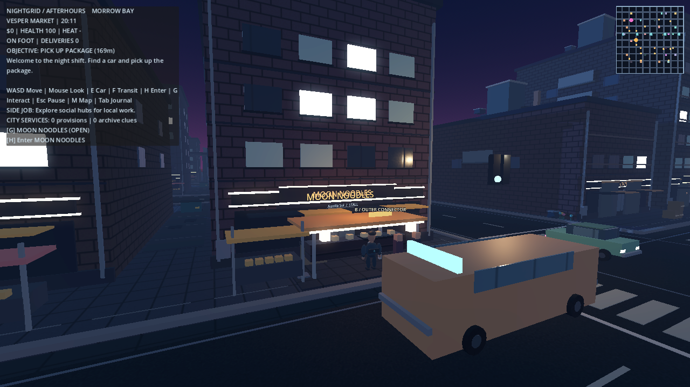
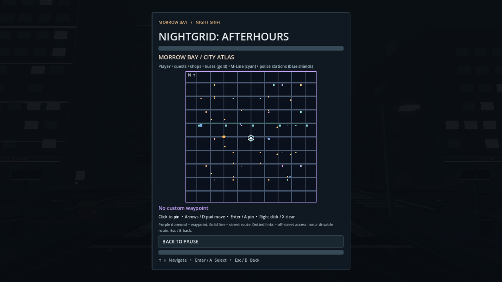

# NIGHTGRID: AFTERHOURS

**An original 3D, open-world night-courier and crime sandbox prototype.** A neon city, parked vehicles, delivery missions and basic police pursuit — no copied Rockstar assets.

## Actual in-game screenshots


*Downtown Morrow Bay after dark — rendered directly from the running game.*

| Vesper Market / Moon Noodles | M-Line / Helix Terminal |
|:--:|:--:|
|  |  |
| **Horizon Commons — daytime** | **Quay Fresh — enterable interior** |
|  |  |
| **Main menu — title screen** | **City atlas — map screen** |
|  |  |

The images above predate the new PBR/atmosphere pass and will be recaptured after visual validation. They are **real, unedited Godot 4.3 framebuffer captures**, not AI-generated artwork, concept mockups or marketing renders. The repeatable screenshot workflow ran the playable scene at **1280 × 720** on a Linux X11 virtual display using Mesa's software **OpenGL Compatibility renderer**. The downloadable Windows build defaults to **Forward+/Vulkan**, so its lighting and reflections can differ. [See how the captures were generated and verified.](docs/screenshots/README.md)


## Play the first prototype

1. Download [Godot 4.3+](https://godotengine.org/download/), standard version (no .NET).
2. Clone the repository, or select **Code → Download ZIP** on GitHub.
3. Open `project.godot` in Godot.
4. Press **F5** to play. Head for the amber pickup beacon; deliver the package to the cyan destination and earn money.

### Real menus and gamepad controls

The first Windows launch now opens an interactive **title screen** with Continue, New World, Settings, Controls and Quit. **Esc** or controller **Start** opens the pause menu, which freezes the world and provides Resume, Save, Load, New World confirmation, a full-size **City Map**, and an objective/inventory **Journal**. Settings persist in `user://settings.cfg` (volume, mouse/joystick sensitivity, Y inversion, reflections, bloom, contact shadows, atmospheric haze, VSync and FPS overlay). The stored world seed and building manifest remain separate from settings.

| Keyboard / mouse | Standard Xbox gamepad | Action |
|---|---|---|
| WASD + Mouse | Left / Right sticks | Walk and look |
| Shift / Space | L3 / A | Sprint or jump on foot |
| W/S, A/D, Space | RT/LT, left stick, B | Drive, steer, brake |
| E | Y | Enter/exit car |
| F | RB | Board/leave a bus or train at a stop |
| H | LB | Enter/leave an indoor business |
| G | X | Interact with a shop, club or civic service |
| 1 / 2 | A / X inside a dialogue | Purchase service / accept or finish job |
| R | D-pad Down | Consume a supply pack on foot |
| Esc | Start | Pause/resume and access menus |
| M | View/Select | Enlarged city map |
| Tab | Pause > Journal | Quest, inventory and city journal |
| F5 / F9 | Pause > Save/Load | Save or restore persistent city |
| F6 | Pause > New World | Confirm a new-world seed |
| F3 / F4 | Pause > Settings | FPS/chunk overlay and screen-space reflections |
| T / Y | — | Debug clock advance/pause |

Buttons and sliders support controller focus and navigation. The game distinguishes keyboard and gamepad HUD hints; **B brakes when driving** and acts as Back only in a menu. This maps standard Xbox-style devices via Godot's joypad API; **real physical controllers have not yet been tested**. Detailed bindings and limitations: [Menus and input guide](docs/INPUT_MENUS.md).

### Updated world lighting and materials

The new physical-material pass adds **procedural albedo + normal + roughness texture maps** for brick, concrete, asphalt, pavers, metal, glass and rainwater. These cached textures are shared by exterior and interior environments. Building facades use tinted reflective glass for inactive windows and storefront doors, while lit neon signs retain their separate emissive treatments.

The city also uses **filmic tone mapping**, subtle screen-space contact shading (SSAO), and cool-night/warm-day distance haze. The 16 fixed rain puddles have irregular, low-profile shorelines instead of raised rectangular slabs. Both player vehicles and NPC cars/buses now have round wheels, alloy hubs and clearer cabin/window detailing. These are incremental visual upgrades, **not a claim of photorealism or measured 60 FPS**.

Use **Pause → Settings** to toggle SSR, bloom, ambient occlusion or haze independently when comparing quality versus frame rate. [Rendering handbook and profiling protocol](docs/RENDERING.md).

### CICADA M8 — cinematic elevated rail

Our first hero-asset pass applies the game's new **hyper-realistic, stylized cyberpunk-futurist art direction** to the actual playable M-Line train. The two-car consist now includes a bespoke bevelled metal body, transparent cabin glazing with seats and grab poles, sliding doors timed to station stops, articulated gangway bellows, multiple rail bogies and wheels, reversible marker/headlights, and detailed roof services. All five elevated stations have canopies, wayfinding, safety paving, lighting, and visible elevator-to-platform bridges. The five-stop movement and saved-world railway state are unchanged.

**Images above were captured before this rail upgrade.** We will replace them only with validated, real game captures. See [the whole-game visual art brief](docs/ART_DIRECTION.md) for our quality bar and known limitations.

### KESTREL S6 — the playable street car hero asset

The second major asset pass replaces the 12 parked player-drivable cars' boxy placeholder bodies with an original **KESTREL S6** fastback electric vehicle and equips spawned police cruisers with a matching pursuit edition. The real car now renders a lofted bevelled monocoque, metallic clearcoat paint, tinted panoramic glass with visible four-seat cabin, steering and spinning alloy wheels, roof module, service panels, cooling vents and detailed trim. Brake/reverse lighting responds to real control inputs, active headlights illuminate the path only while cars are driven or pursuing, and original generated electric drivetrain audio responds to speed. All driving physics, collisions, ownership, save IDs and player controls are unchanged.

See [Kestrel S6 implementation and visual QA requirements](docs/KESTREL_S6.md). The committed screenshots above predate both this car and the upgraded train.

### CENTRAL EXCHANGE — hero street intersection

Morrow Bay's third authored quality slice upgrades the **playable crossroads at (0, 0)** into an infrastructure-grounded cyberpunk landmark. All four zebra crossings now have abrasion and reflective studs; the corner curbs open onto **eight sloped pedestrian ramps**, and the gutters have detailed cast-iron drains, irregular asphalt patches and shallow rainwater. The original **working two-phase traffic heads** gain real masts and control hardware, plus readable city wayfinding, protective bollards and one night-only practical light.

This is part of the playable city, **not** a separate showcase map or a fake static traffic scene. The original right-hand lanes, traffic controls, saved-world geometry and driving mechanics remain unchanged. See the [Central Exchange hero quality sheet](docs/CENTRAL_EXCHANGE.md). Current README screenshots still predate this pass.

### LANTERN CUP — cinematic, enterable Vesper Market café

Our fourth hero-asset upgrade is a **real in-game venue**, not a showroom screenshot. The canonical **Lantern Cup**, run by Mara, now has an original custom streetfront with tinted glass and copper lanterns and a uniquely furnished indoor coffeehouse: polished brewing machines, fitted walnut/copper décor, soft seating and tables with collision, acoustic ceiling, real stock shelving, 12 suspended lamps, detailed service menus, three animated steam wisps and a new original spatial coffee-pump sound.

**Play it:** Walk to Lantern Cup on foot, press **H** to enter, **G** at the counter to buy a drink using the existing $18 / +20-health service, or press **G** at Mara's right rear booth to discover a persistent shift note. Leave with **H** near the entrance. Its hours, address, staff, existing quests and save-format remain unchanged. See [the hero café specification](docs/LANTERN_CUP.md). README screenshots remain **pre-upgrade** until real new gameplay captures are validated.

### Streamed city geometry and enterable interiors

- **On-demand geometry:** nearby district blocks create building colliders, signs and detailed facade MultiMeshes. Distant blocks unload and reconstruct identically on return from the saved world manifest and seed.
- **Enter all 28 named businesses:** approach an exterior storefront on foot and press **H**. Rooms have collidable floors/walls, a clear door, counters, host silhouettes, local lighting and different furnishings for markets, clinics, emergency services, libraries, municipal offices, garages, warehouses, power facilities, stalls, cafes, bars and clubs.
- **Services in person:** walk to a staffed counter, press **G**, then select **1/2** for useful services or contracts. Return to the door with **H**. Outdoor G interactions remain available.
- **Save while inside:** F5 stores the interior site ID and street return coordinates; F9 restores the same room and all inventory/jobs. Old saves remain compatible.
- **Scope:** structural-block mesh/collision streaming and a single active indoor room—not full asynchronous world streaming. Transport, roads, vegetation and service frontage props remain resident. Interiors use a separate room transition rather than physical openings in exterior building shells; frame rates remain unmeasured.
- See [Streaming and interiors](docs/STREAMING_INTERIORS.md) for technical architecture and tests.

### Outer districts, civil services and preserved world layouts

- **Four new districts**: North Quay (markets and harbor services), West Docks (freight and workshops), Horizon Gardens (housing, clinics and parks), Southworks (civic offices, utilities and industrial deliveries).
- **Eight protected landmarks total**; **64 total blocks** and **112 authored or seed-selected building profiles**—the 6×6 downtown is kept intact while a new ring is added.
- **16 functional public-service sites**: grocers, clinics, emergency/fire services, libraries, warehouses, garages, civic service desks and a power annex. Press **G** near a service counter; use **1** to buy provisions, recover, repair vehicles or check records; use **2** for four one-time freight contracts.
- **R** consumes a purchased take-away ration pack on foot (+25 health). Park damaged cars by garages to repair them.
- **81 road signals**, **25 civilian cars**, **4 boardable buses** with **16 stops**, **5 elevated rail stations** and coverage in all eight districts.
- **Real world persistence**: a world seed *and an exact 112-building manifest* are saved in slot 1; save/load never rerolls existing chosen parcels. New Game F6 chooses a new layout, while fixed roads/landmarks/shops remain fixed.
- [Expansion and public services guide](docs/EXPANSION.md). These now connect to furnished interior room instances, although individual establishments do not yet have bespoke floorplans.

### Social life after dark

- **12 fixed, named destinations** across Vesper Market, Glassline, Brickwater and Afterhours: three cafes, three late-night food stalls, three bars and three nightclubs.
- Each has authored streetfront decor, hosts, its own schedule, lighting, and proximity-triggered original ambient audio. Counter details, tables, shelves, bowls, signage, marquees and silhouettes use the graphic-noir palette, not generic storefront repetition.
- Approach on foot and press **G** for the local menu. Use **1** to purchase useful health or police-heat services, **2** to take/complete one of four authored cross-district side jobs. Hours and contacts matter.
- Venue pins and active side-job targets appear on the minimap. Side-job progress survives the existing **F5/F9** save/load and preserves old save compatibility.
- See the [Morrow Bay venue and side-story guide](docs/VENUES.md). They now have enterable themed room instances, accessed with H.

### City transport and persistent worlds

- **Morrow Bay City Loop:** four low-poly buses across two rings, sixteen far-side curb stops, player boarding and alighting with **F**.
- **M-Line:** moving two-car elevated train, five fixed stations and marked street-level entrances.
- **Traffic:** 25 NPC cars follow right-hand lanes, traffic signals with yellow/all-red clearance, speed limits and basic safe following distance.
- **New Game seeds:** roads, landmarks and transit remain authored; eight curated alternative building parcels, decorative details and flora use the saved seed. **F5** saves seed + player/world state, **F9** restores, and **F6** creates a fresh seeded world without overwriting the previous save.
- Full infrastructure design and limitations: [Transport network](docs/TRANSPORT.md).

### Included in the first vertical slice

- Authored Morrow Bay geography expanded to **8 districts / 64 blocks**, with eight stable landmarks and 112 seeded-and-saved building profiles. The **four original downtown neighborhoods** remain Vesper Market, Glassline, Brickwater, and Afterhours, with four new outer districts. Each has distinct skylines, facade shapes, storefronts and street dressing.
- Third-person character with walking, sprinting, jumping and a follow camera.
- Twelve parked arcade-drivable cars with collisions and repairable collision wear.
- Repeatable courier pickups and deliveries, cash payouts.
- Heat / wanted level, pursuing police, health damage, hospital respawn.
- HUD with objective, cash, health, speed, and a city minimap.
- Procedural details: crossings, painted roads, lit windows, rooftop HVAC/water towers, fire escapes, storefront names, market stalls, signal units, benches, vending machines, hydrants, trees, crates, service alleys and distant skyline.
- Real 24-hour lighting cycle (24 real minutes), two sky palettes blended through dawn/dusk, and nighttime neon response. Press **T** to skip one hour and **Y** to pause the clock.
- Purpose-planted low-poly flora: ginkgo, pine, flowering plum, ficus, shrubs, flowers and district planters, using batched GPU instancing.
- Eight fixed locations, including Lantern Court, Helix Terminal, Foundry Commons, Sable Square and four new civic district landmarks. See the [Morrow Bay World Bible](docs/WORLD_BIBLE.md).
- Cached 128px tiled PBR surface maps (brick, concrete, pavers, metal, glass, wet asphalt), handcrafted wet-street reflective patches and 8 pooled nighttime lights; see [Rendering guide](docs/RENDERING.md).
- Original procedural placeholder graphics — no external art/audio dependencies. For neighborhood layout and technical notes, see [City Atlas](docs/CITY.md) and [Expansion guide](docs/EXPANSION.md).

### Known limits

**Prototype, not a finished release:** this has not been manually tested in a Godot editor on a gaming PC. CI runs file checks, a Godot 4.3 import, and city composition assertions and a short headless smoke test, but gameplay feel needs hands-on review. There are now lane-following NPC traffic, a single save slot, public transit, a menu system and themed physical interior rooms, but no moving street pedestrians, complex story campaigns, uniquely bespoke floors for every site, multiplayer, or full music production yet. The social hubs have original spatial ambience. Driving uses an arcade `CharacterBody3D` instead of suspension/tire physics.

Godot now uses the **Forward+ Vulkan renderer** for SSR and glow (with F4 reflection toggle), **not DirectX**. This was chosen for rapid iteration on Windows/Linux. A native DirectX engine is possible later if justified by a clear requirement.

## Roadmap

1. **0.1 — Playable:** working city, basic game menus, controller action map, physical interiors and a Windows playtest build; validate feel and collisions on real hardware.
2. **0.2 — Living city:** streamed district geometry, pedestrians, weather, indoor spaces and richer NPC schedules.
3. **0.3 — Emergent systems:** more jobs, vehicle ownership, police escalation, NPC schedules and a stronger identity.
4. **0.4+ — Expand responsibly:** measured performance budgets, dense district content, broader accessibility, controller rebinding/haptics, and modding.

## Download a Windows build

On GitHub, open **Actions → Windows playtest build → latest successful run**, then download the `nightgrid-afterhours-windows-x64` artifact. Unzip and launch `NightGrid-Afterhours.exe`. The game is an alpha and may trigger Windows SmartScreen because the executable is unsigned. The workflow builds from this source; it is not a standalone release yet.

## Local checks

```bash
python3 tools/check_project.py
godot --headless --path . --import --quit
godot --headless --path . --script res://tests/city_smoke.gd
godot --headless --path . --script res://tests/world_systems_smoke.gd
godot --headless --path . --script res://tests/render_smoke.gd
godot --headless --path . --script res://tests/transport_smoke.gd
godot --headless --path . --script res://tests/expansion_smoke.gd
godot --headless --path . --script res://tests/streaming_interiors_smoke.gd
godot --headless --path . --script res://tests/menus_gamepad_smoke.gd
godot --headless --path . --quit-after 90
```

Source is deliberately unlicensed until the owner chooses an explicit license. All code/assets are original starter work.
