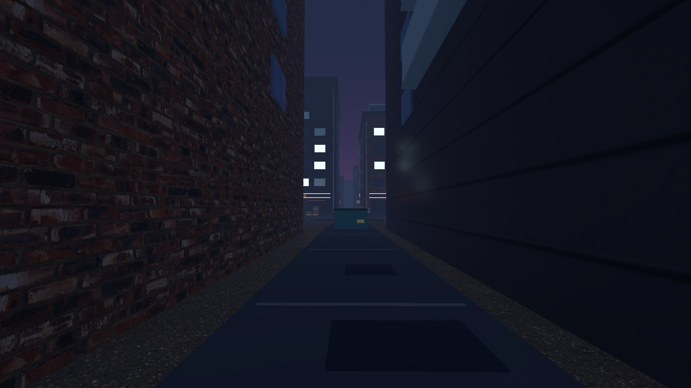
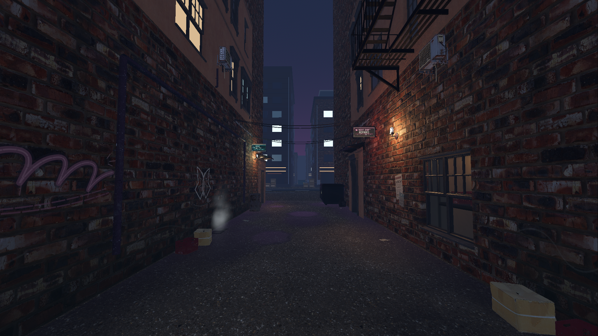
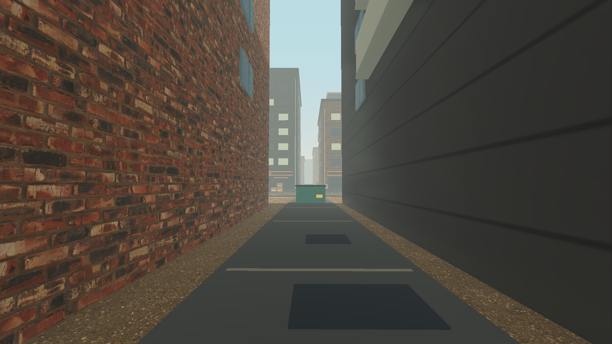
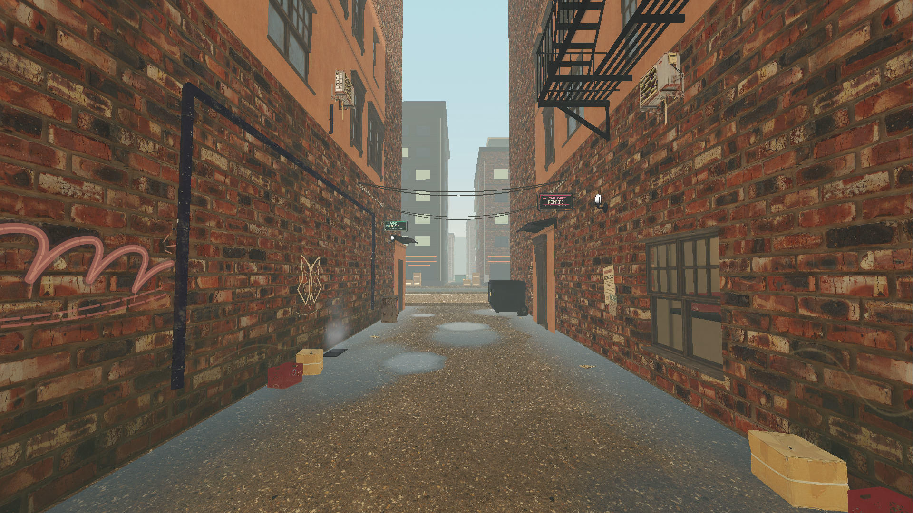
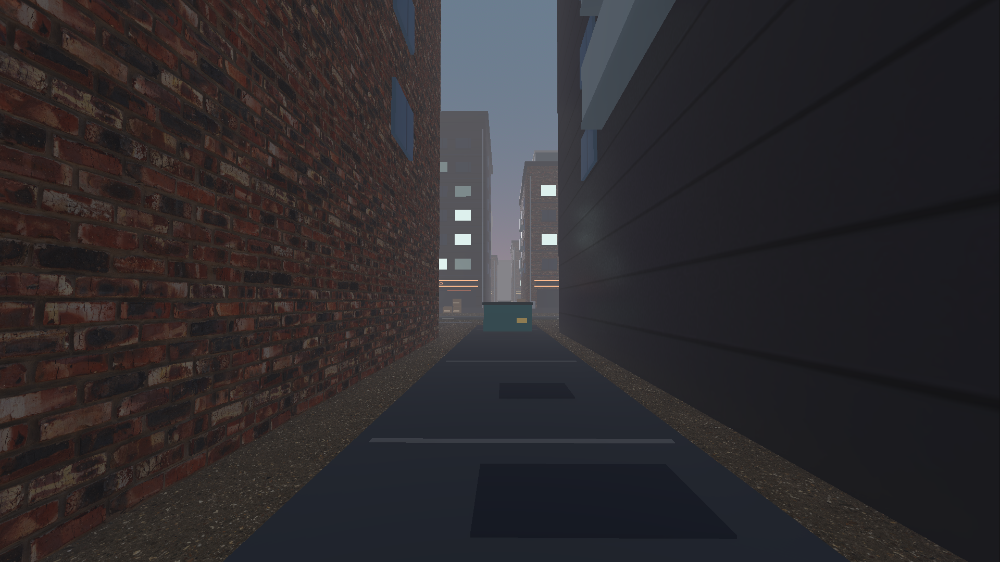
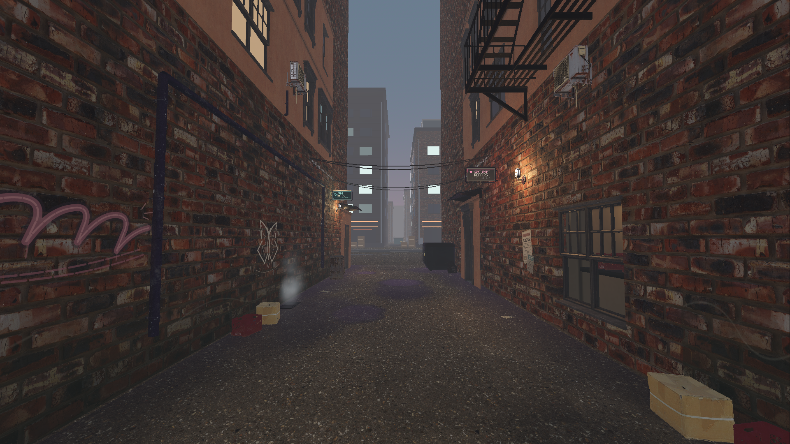
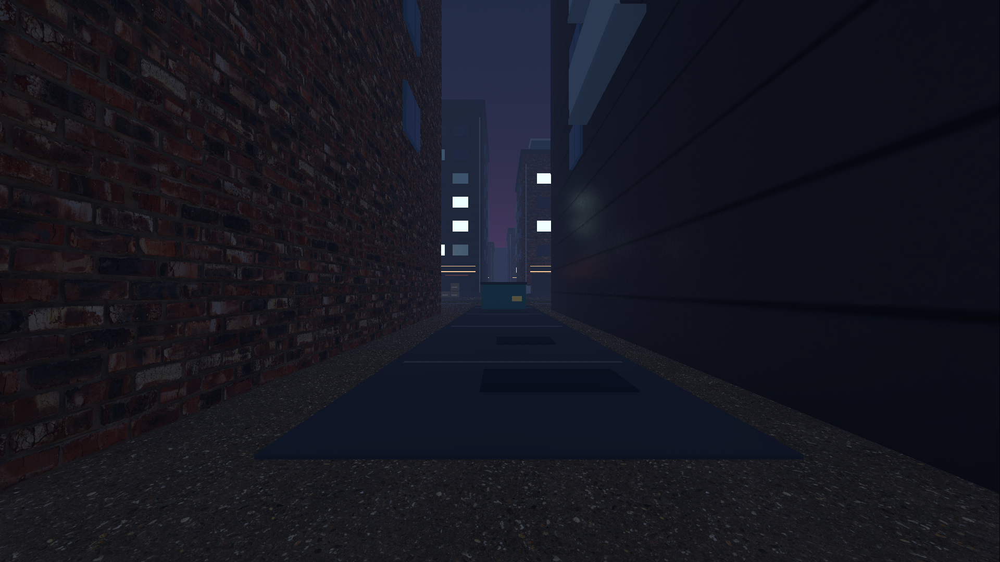
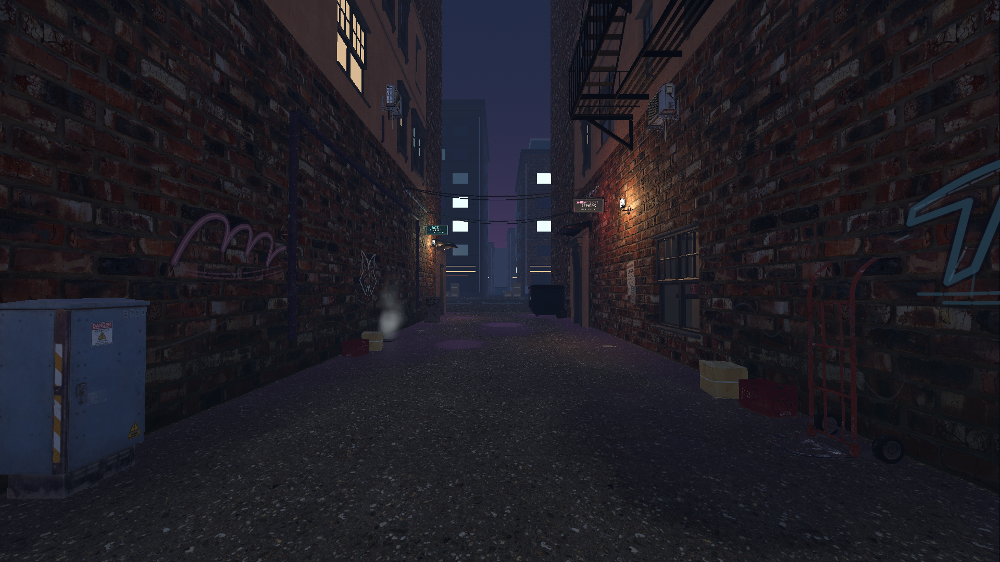
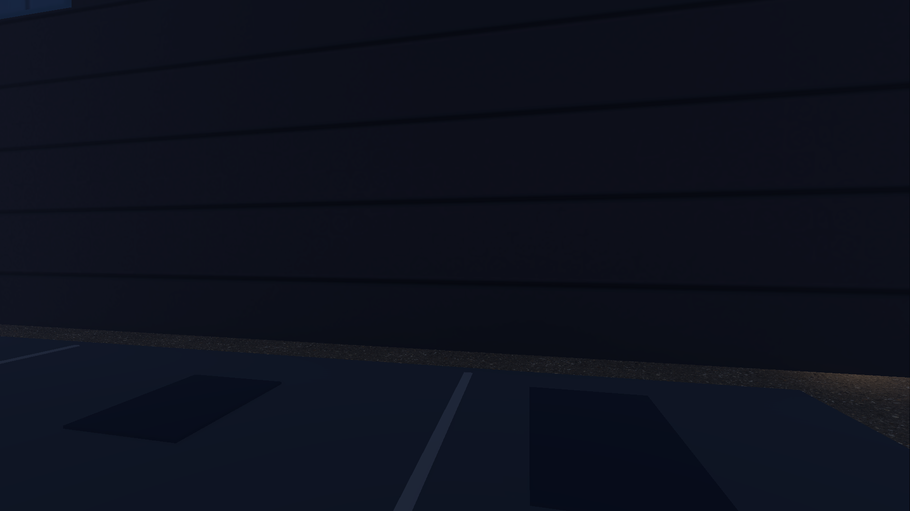
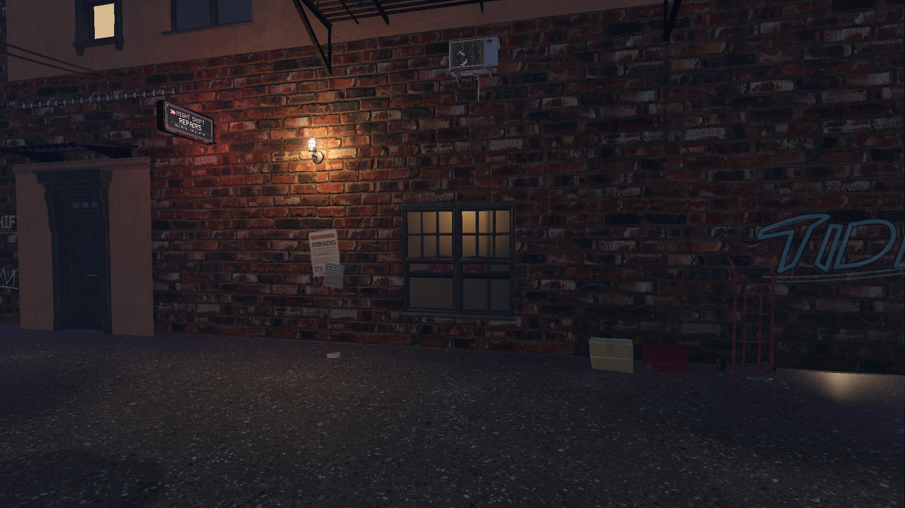

# Brickwater in-game comparison

These are raw framebuffer PNGs from the playable Windows build in Godot 4.7.2 Forward+ with Vulkan. The frames use matching coordinates, lens, resolution and clock at block `(-2, 1)`. The capture script parks the gameplay camera and hides the HUD and player for architecture review. The baseline is beta.7 at `78442f9`. The implementation is `6c7ac1e`.

| View | Beta.7 | Consolidated |
| --- | --- | --- |
| Street eye, 22:06 |  |  |
| Street eye, 12:00 |  |  |
| Street eye, 19:09 |  |  |
| Driving-height approach |  |  |
| Workroom and masonry close-up |  |  |

The raised black patches and oversized alley dumpster are gone. Both sides have backed recessed glazing, and the repair-shop window shows stock and a shelf behind the glass. The night signs remain legible under the existing bloom and exposure. The street beyond the alley retains its beta.7 architecture. The closed doors, shallow display room and steel escape are exterior scenery. The user-supplied concept is retained in the design chat. This comparison is against the playable baseline.

## Windows frame intervals

Measured on an RTX 3060 12 GB, driver 621.24, and Ryzen 7 2700X at 1920 × 1080. SSR, AO, glow and fog were enabled. VSync was off and physics stayed at 60 Hz. The 44.5–44.6 m live player route passed through the alley and across the next block boundary. The first pass loaded 13 chunks in each revision. The repeat loaded zero. The camera rows above are fixed views. The traces below use live player physics and the game's F8 recorder.

| Revision and pass | Median ms | p95 ms | p99 ms | 1% low FPS | Frames over 33.3 ms |
| --- | ---: | ---: | ---: | ---: | ---: |
| beta.7 first | 7.89 | 13.08 | 50.00 | 8.74 | 12 |
| beta.7 repeat | 9.52 | 11.11 | 12.82 | 74.27 | 0 |
| Consolidated first | 9.09 | 12.12 | 59.42 | 10.58 | 8 |
| Consolidated repeat | 9.09 | 12.50 | 13.95 | 65.91 | 0 |

The repeat pass fit the 16.67 ms budget at p99. The first pass still had long streaming stalls. Godot reported about 809 MiB of renderer video memory for beta.7 and 1,039 MiB for the candidate after each capture session. These are renderer allocations observed at the end of the capture, not process-wide peaks. A separate Forward+ run with SSR disabled rendered all nine views without shader errors. Driving traversal, manual controller review and artist acceptance remain open in [#152](https://github.com/ProhibitedTV/NightGrid-Afterhours/issues/152).

Camera settings and PNG hashes are recorded in the [beta.7 manifest](before/camera-manifest.json) and [candidate manifest](after/camera-manifest.json). Raw CSVs are available for [beta.7 first](before/walk-first.csv), [beta.7 repeat](before/walk-repeat.csv), [candidate first](after/walk-first.csv) and [candidate repeat](after/walk-repeat.csv). See the [implementation and provenance](../../BRICKWATER_CONSOLIDATED.md) for the capture commands.
