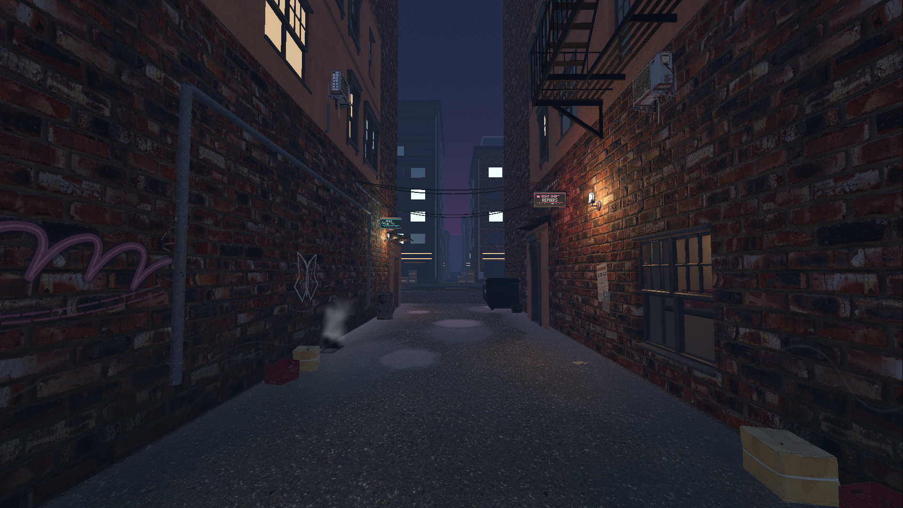

# Windows streaming evidence

The reference is `a1c6863`, which adds instrumentation to PR #163. The measured runtime is `bab9a2c`. All runs used Windows Godot 4.7.2 Forward+ / Vulkan at 1920×1080 on an RTX 3060 12 GB with driver 621.24, Ryzen 7 2700X, and 31.9 GiB RAM. Both revisions used seed 834726, a 60 Hz physics tick, VSync off, and SSR, AO, glow and fog enabled. Cold refers to unvisited chunks in a fresh process. Shader and driver caches were left in their normal state. Each session followed the same route twice.

The table uses the game's F8 frame time. The statistics file also reports median, p95, p99, maximum and threshold counts using elapsed wall time between viewport draws. Engine catch-up can limit the game delta during extreme stalls, so maxima from the two clocks can differ. The reverse-order runs are labeled “confirm.” All 24 passes reached their endpoints.

| Scenario | Revision | Pass | Median ms | p95 ms | p99 ms | Max ms | >16.67 ms | >33.3 ms | New chunks |
| --- | --- | --- | ---: | ---: | ---: | ---: | ---: | ---: | ---: |
| Brickwater immediate | reference | First | 9.09 | 12.51 | 43.25 | 134.46 | 12 | 8 | 13 |
| Brickwater immediate | reference | Repeat | 9.89 | 13.64 | 14.89 | 16.20 | 0 | 0 | 0 |
| Brickwater immediate | candidate | First | 8.33 | 10.61 | 13.90 | 133.33 | 3 | 2 | 13 |
| Brickwater immediate | candidate | Repeat | 9.09 | 11.67 | 14.42 | 15.81 | 0 | 0 | 0 |
| Brickwater settled | reference | First | 9.26 | 11.11 | 16.67 | 133.88 | 5 | 2 | 13 |
| Brickwater settled | reference | Repeat | 11.73 | 66.67 | 136.53 | 150.00 | 64 | 38 | 0 |
| Brickwater settled | candidate | First | 7.58 | 12.24 | 16.67 | 29.55 | 4 | 0 | 13 |
| Brickwater settled | candidate | Repeat | 9.09 | 12.40 | 15.00 | 18.76 | 2 | 0 | 0 |
| Brickwater settled, confirm | reference | First | 9.09 | 13.33 | 15.67 | 133.66 | 4 | 2 | 13 |
| Brickwater settled, confirm | reference | Repeat | 10.00 | 12.96 | 15.48 | 15.95 | 0 | 0 | 0 |
| Brickwater settled, confirm | candidate | First | 8.33 | 11.11 | 14.57 | 22.75 | 2 | 0 | 13 |
| Brickwater settled, confirm | candidate | Repeat | 9.09 | 51.49 | 144.50 | 150.00 | 61 | 40 | 0 |
| Drive at 21:30 | reference | First | 19.70 | 27.78 | 35.01 | 149.76 | 252 | 8 | 16 |
| Drive at 21:30 | reference | Repeat | 20.83 | 30.30 | 31.56 | 33.01 | 264 | 0 | 16 |
| Drive at 21:30 | candidate | First | 19.05 | 26.70 | 30.09 | 54.62 | 245 | 1 | 16 |
| Drive at 21:30 | candidate | Repeat | 19.70 | 29.17 | 30.52 | 32.24 | 241 | 0 | 15 |
| Drive at noon | reference | First | 15.46 | 25.76 | 29.27 | 146.78 | 159 | 4 | 17 |
| Drive at noon | reference | Repeat | 16.67 | 26.16 | 27.78 | 31.42 | 181 | 0 | 17 |
| Drive at noon | candidate | First | 16.67 | 67.06 | 149.88 | 150.00 | 136 | 46 | 17 |
| Drive at noon | candidate | Repeat | 16.67 | 27.78 | 28.51 | 30.37 | 175 | 0 | 16 |
| Drive at noon, confirm | reference | First | 15.00 | 25.76 | 31.20 | 137.82 | 159 | 4 | 17 |
| Drive at noon, confirm | reference | Repeat | 16.67 | 28.33 | 28.70 | 29.24 | 202 | 0 | 16 |
| Drive at noon, confirm | candidate | First | 14.81 | 25.00 | 27.81 | 50.00 | 160 | 2 | 17 |
| Drive at noon, confirm | candidate | Repeat | 16.67 | 25.76 | 26.04 | 29.29 | 163 | 0 | 17 |

## Attribution and remaining frame cost

The tagged cold chunk-stage peak dropped from 156.20–157.16 ms to 8.01–12.77 ms on the Brickwater walks and from 155.44–161.23 ms to 1.54–2.27 ms on the drives. For example, the immediate walk's replacement WOOD texture submission took 0.134 ms of CPU time. Every reference first pass showed the WOOD bake, while the candidate traces show no runtime material bakes. Both settled candidate first walks had zero F8 and wall-frame intervals above 33.3 ms. The chunk counts on corresponding first routes matched.

The nighttime first drive improved from 35.01 to 30.09 ms p99 in F8, and its longest draw interval dropped from 191.07 to 30.45 ms. At noon the reverse-order run dropped from 31.20 to 27.81 ms p99, and its longest draw interval fell from 182.20 to 29.43 ms. The vehicle reached 130 km/h in every drive and retained full condition. Camera rotation exposed viewport CPU costs that remain above the 16.67 ms target. One candidate noon run and repeat walks on each revision also saw long, unattributed intervals. For example, the candidate noon run recorded a 566.27 ms wall interval while the sampled viewport CPU/GPU values were 12.71/5.05 ms and the longest tagged span was under 0.01 ms. The traces retained the first-view startup spikes and these outlier sessions. Long-run pacing, normal traffic and continuous in-motion visual review keep issue #32 open.

## Brickwater visual check

All nine same-camera, same-clock Windows captures had identical PNG SHA-256 hashes on both revisions. The example below is the shared 22:06 view. These comparisons cover lighting, façades and material response at fixed cameras. Moving pop-in review with normal traffic remains open.

[Raw profiles and F8 CSVs](windows-raw-traces.zip) · [All statistics](statistics.json) · [The nine matched hashes](visual-parity.json) · [Implementation and commands](../../STREAMING_PERFORMANCE.md)
