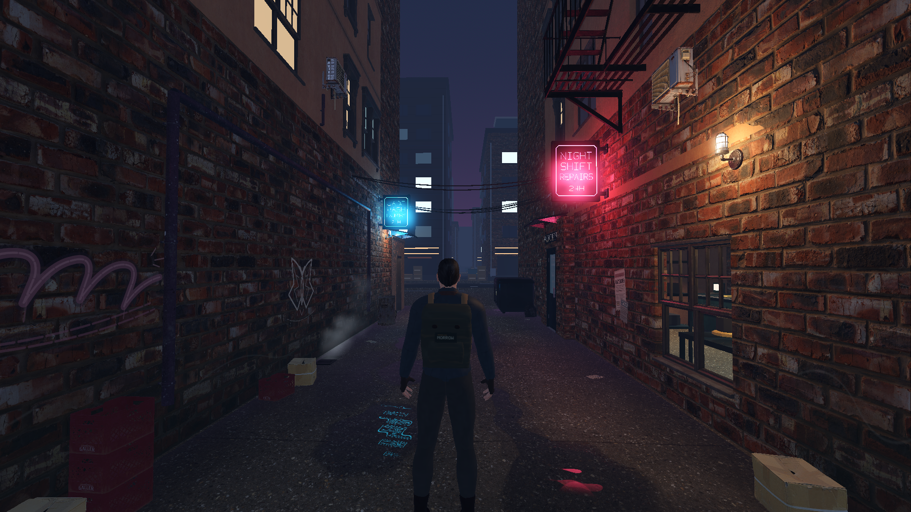
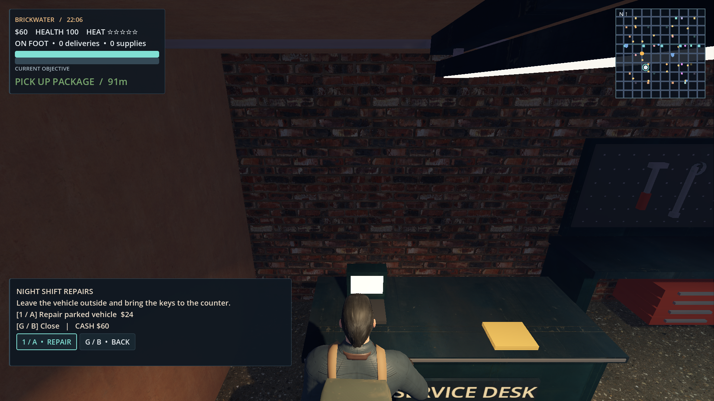
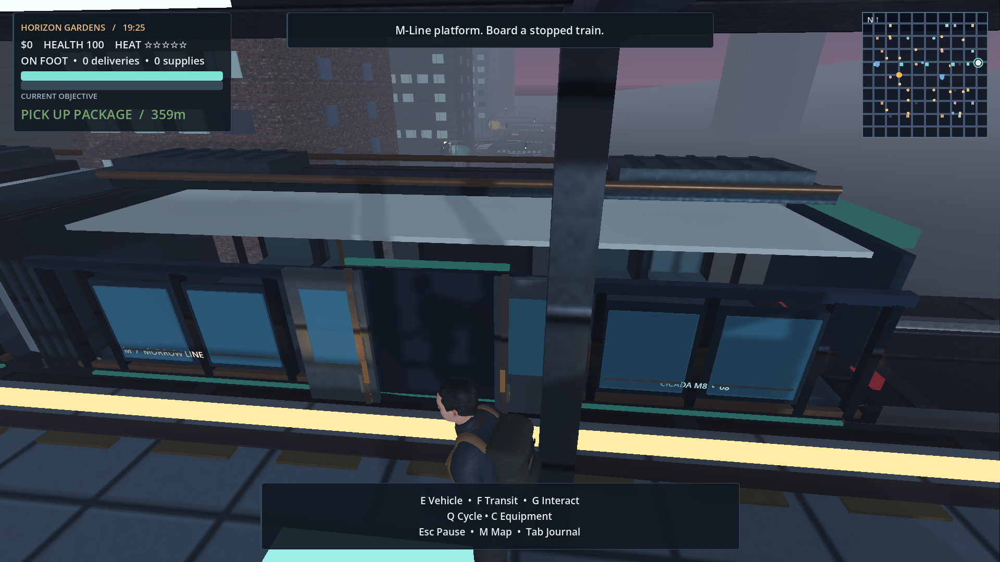
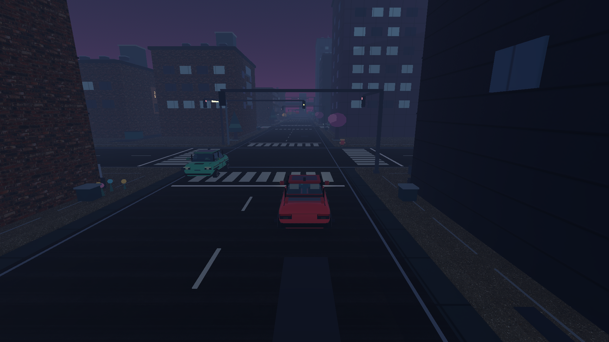
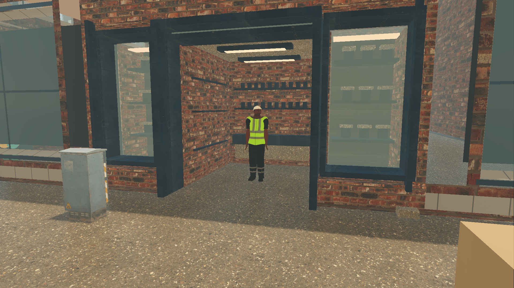

# Beta.8 RC1 gameplay gallery

Windows gameplay from `bd827599672a05b57bf77cd61dcebf7447c6cdfe` with Godot 4.7.2 Forward+/Vulkan at 1920×1080 on an RTX 3060. The replay scripts take these PNGs directly from the game's rendered viewport. The road frame uses a repeatable camera after timing. [Capture provenance](provenance.json) · [Review notes](../../BETA8_RC1.md).

Brickwater service alley at 22:06 with the new signs and wet pavement.

The courier at the Night Shift Repairs counter after walking through the actual door.

East Gardens platform during the lift and rail-boarding replay.

Southworks chase camera at a fixed point after the multi-district run.

Brickwater with the experimental Living Streets population enabled at noon.
