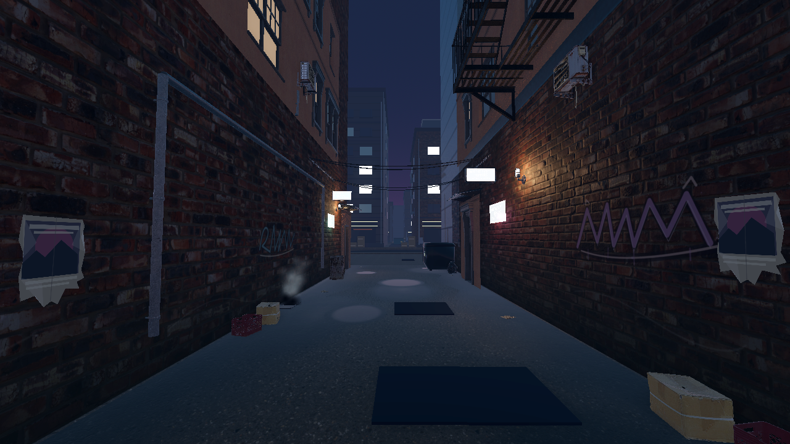
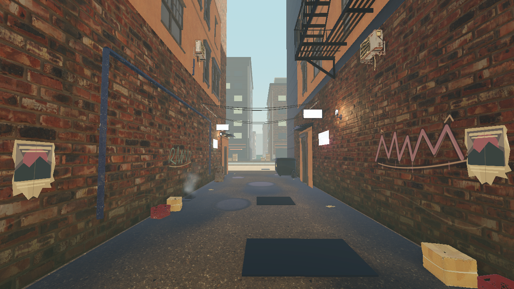
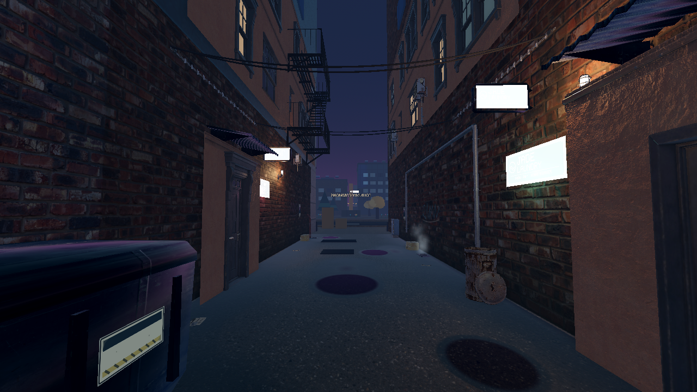
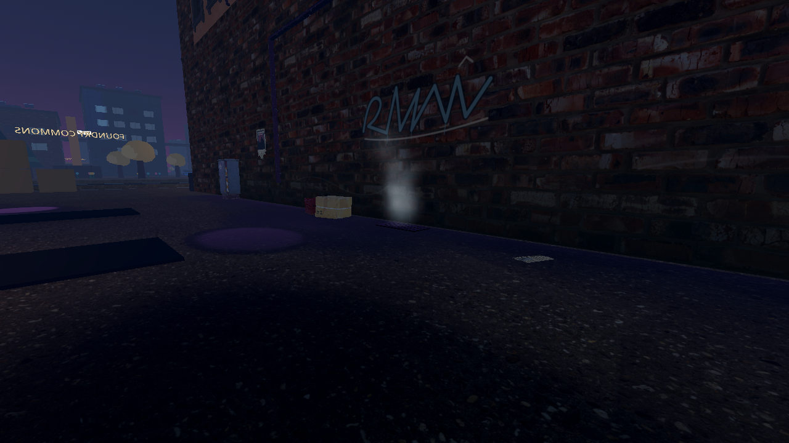
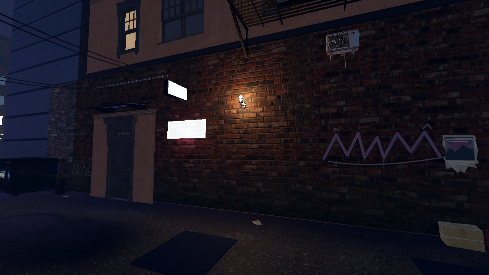
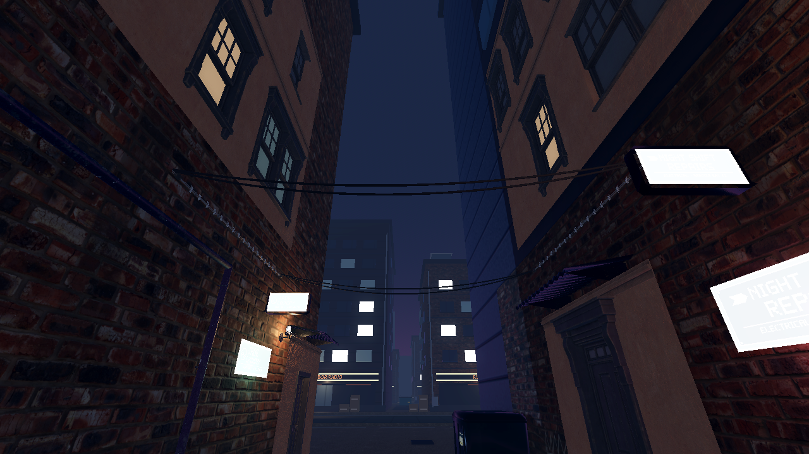
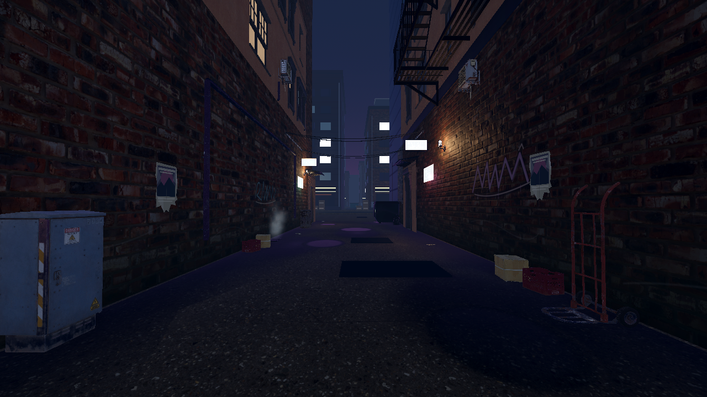

# Brickwater historical alley review

Seven original framebuffer captures from [PR #157](https://github.com/ProhibitedTV/NightGrid-Afterhours/pull/157), archive commit `36955f37f58524001a7ae536ee82b94d40918f6b`, rendered revision `05938393ecfd15354b55cf2c3d06c4daf156717c`. The original camera manifest records camera coordinates, clock, FOV, renderer, dimensions and hashes. File lengths match all seven manifest entries and recorded hashes are distinct. These are historical software OpenGL captures, not native RTX or current-main visual acceptance. Current main has newer Brickwater scripts; this port does not replace runtime code.

[Manifest](camera-manifest.json) · [Screenshot index](../README.md)

## alley night north

## alley daylight matched

## alley night south

## wet ground and drain

## graffiti and service front

## overhead infrastructure

## driving height approach

