# Morrow Bay — native Windows development gallery

**13 genuine unedited 1920×1080 Godot 4.7.2 Forward+/Vulkan screenshots on an RTX 3060.** Curated from the original binary captures committed to draft PRs #163, #165 and #166. Images are **not from the downloadable Beta.7** and do **not** represent one accepted, combined playable build. Some camera positions are staged to review art. Screenshots are not a performance benchmark.

[Back to project](../../../README.md) · [Nine-image existing gallery](../README.md) · [Provenance and source blobs](provenance.json) · [Download Beta.7](https://github.com/ProhibitedTV/NightGrid-Afterhours/releases)

## Brickwater — art and environment

| Alley at night | Matched camera in daylight |
|:--:|:--:|
| 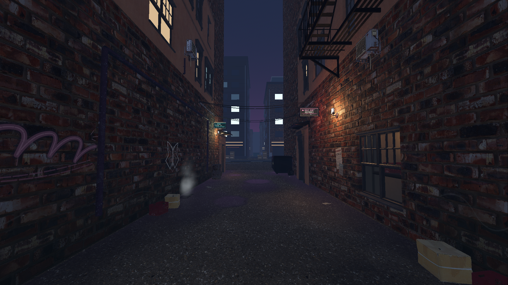 | 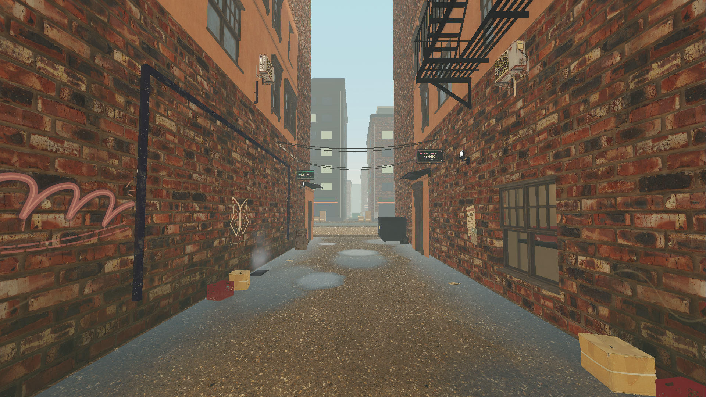 |

| Repair-shop display | Alley at dusk |
|:--:|:--:|
| 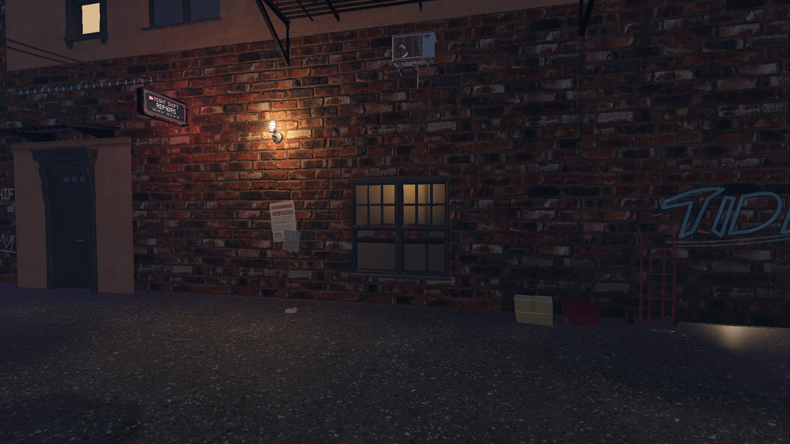 | 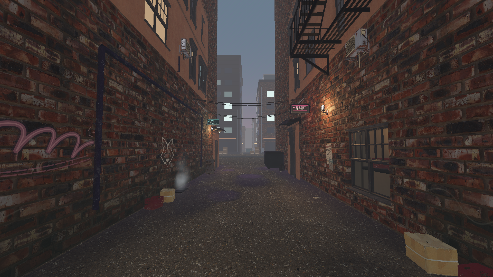 |

[PR #163: exact native before/after pairs](https://github.com/ProhibitedTV/NightGrid-Afterhours/pull/163) · [Unfinished artist acceptance #152](https://github.com/ProhibitedTV/NightGrid-Afterhours/issues/152). The repair-shop display has visible depth, but the shop is not yet continuously enterable.

## Physical world — rail, roads and buildings

| M-Line infrastructure and traffic signals | East Gardens boarding platform |
|:--:|:--:|
| 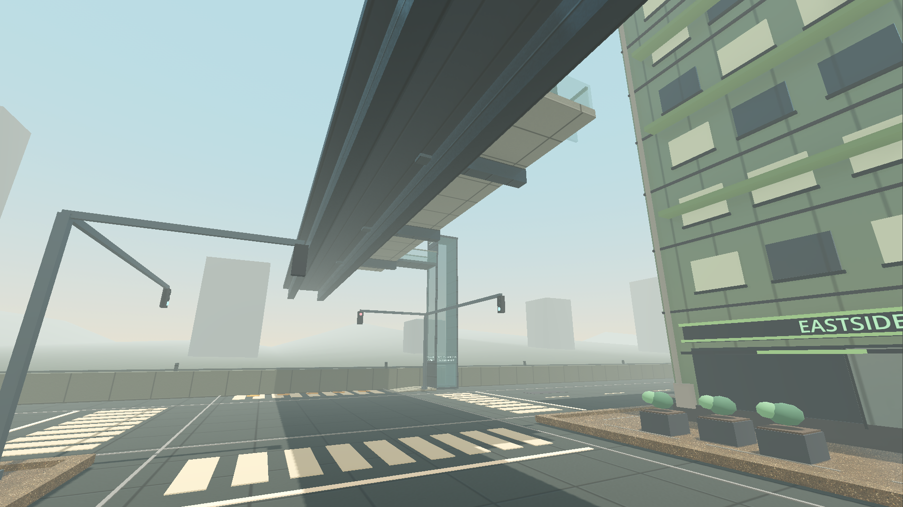 | 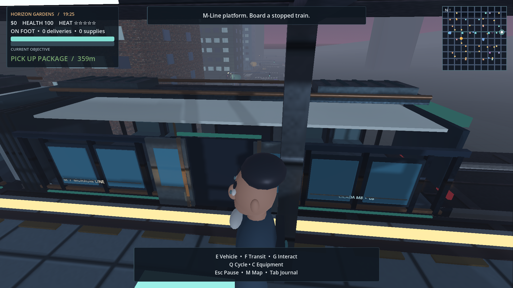 |

| Horizon Commons chase camera | West Docks Pier Storage |
|:--:|:--:|
| 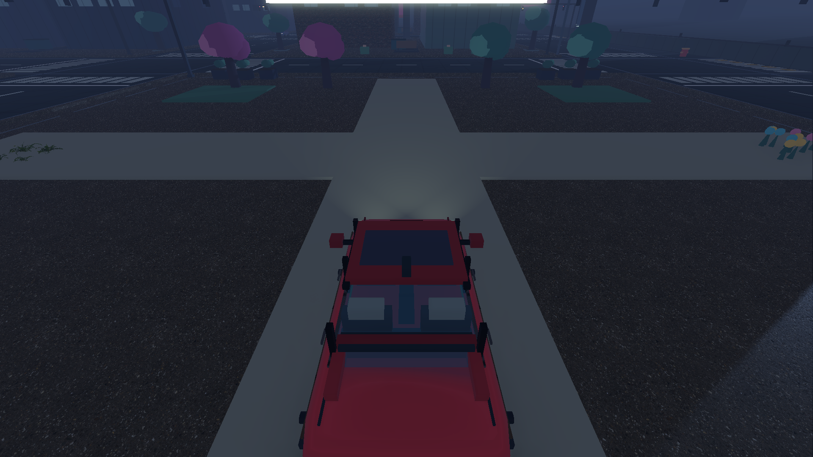 | 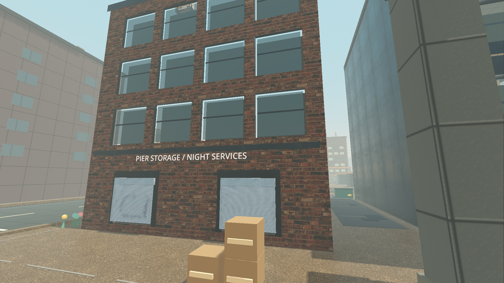 |

[PR #165: full native replay and performance traces](https://github.com/ProhibitedTV/NightGrid-Afterhours/pull/165). Manual controller and full-traffic replay remain unverified.

## Player — skinned Morrow courier

| Daylight face and collar | Rear clothing and pack |
|:--:|:--:|
| 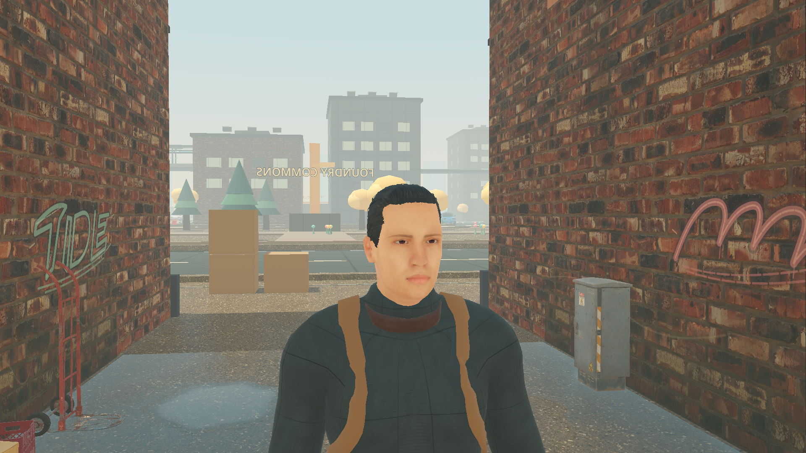 | 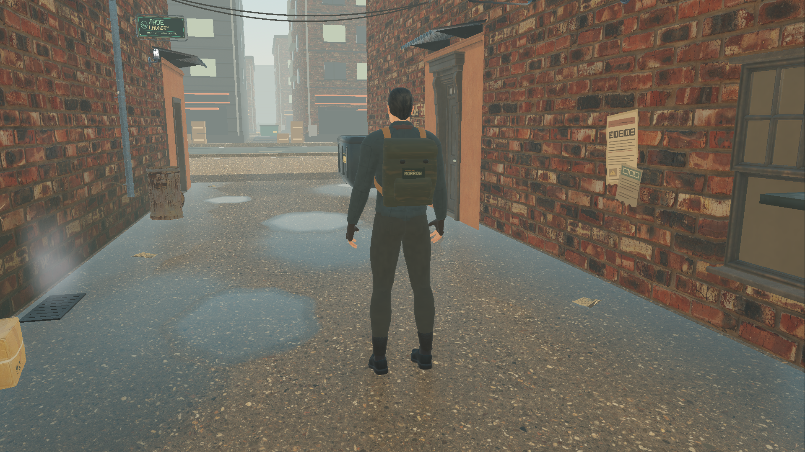 |

| Walking pose | Nighttime game lighting |
|:--:|:--:|
| 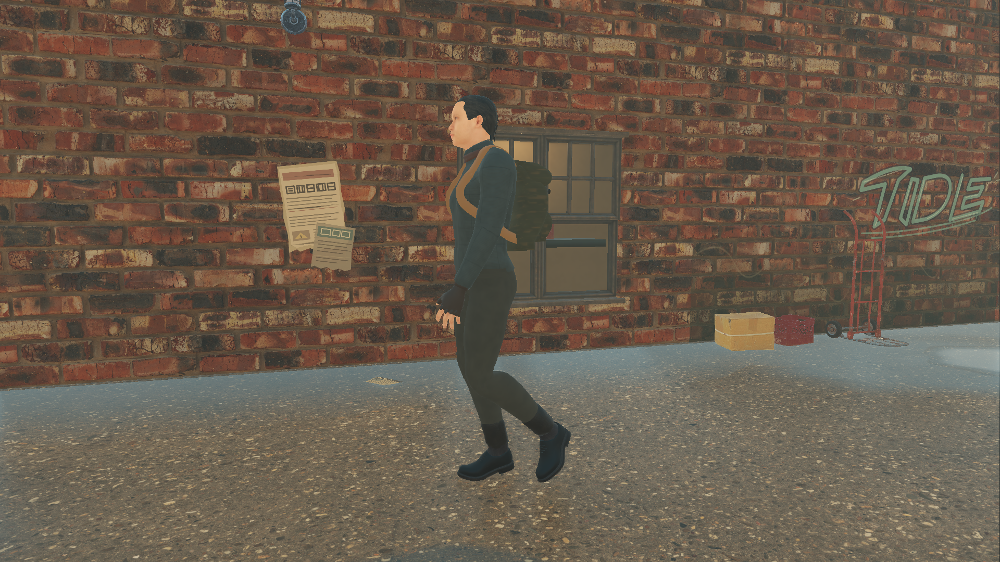 | 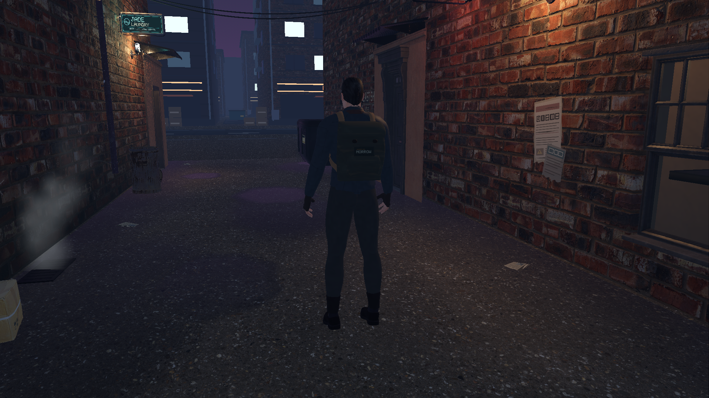 |

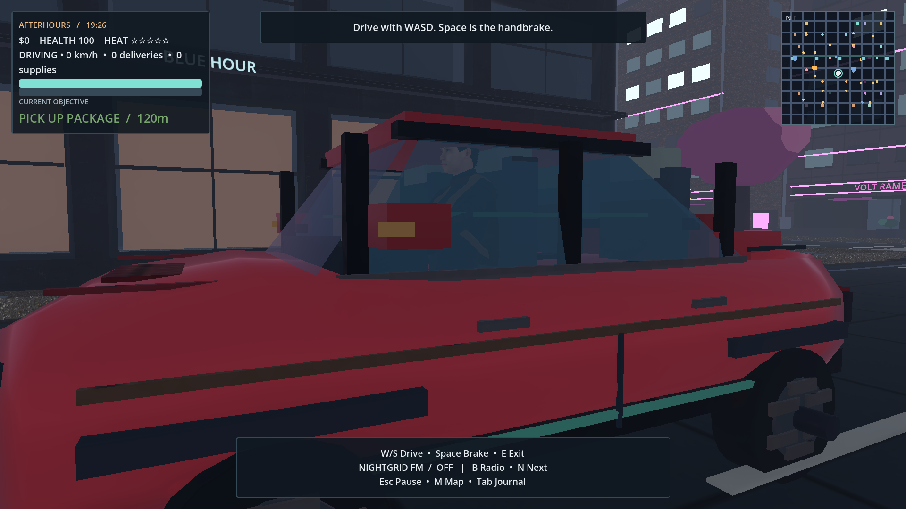

[PR #166: native gameplay footage and animation tests](https://github.com/ProhibitedTV/NightGrid-Afterhours/pull/166). Artistic approval, foot-slip refinement, static vehicle-door intersections and manual controller feel remain open.

## Provenance and caveats

All 13 PNGs are direct Git blob references copied from previously committed game-engine captures. Original capture manifests, checksums, camera parameters, raw F8 traces and native reports remain on the respective PR source branches. The [per-image provenance file](provenance.json) records every original path and SHA; no images were recreated, retouched or substituted. Frame-time and release acceptance cannot be inferred from the selected frames.
