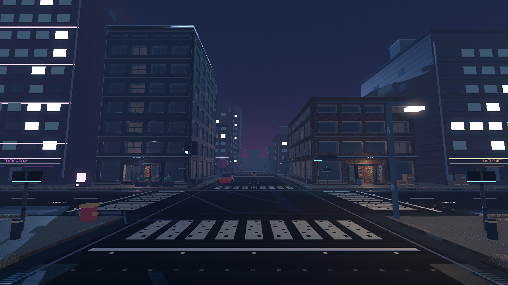
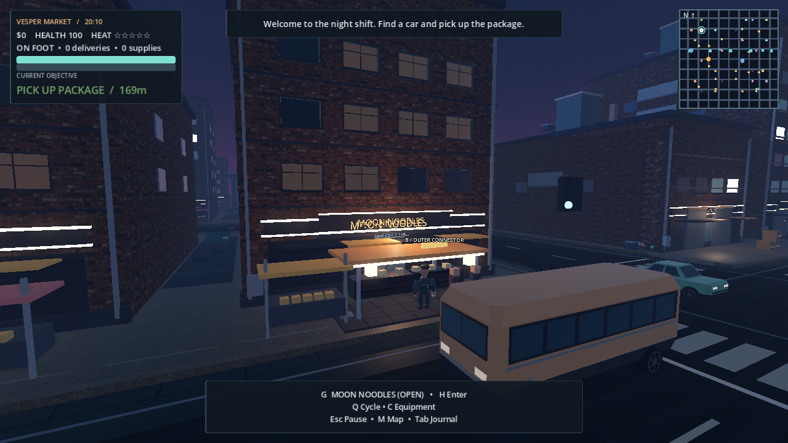
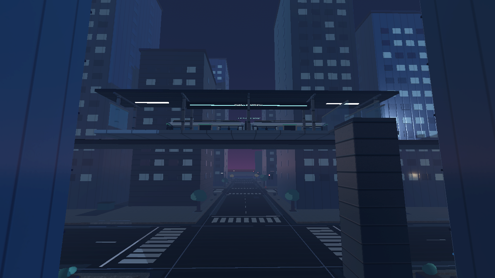
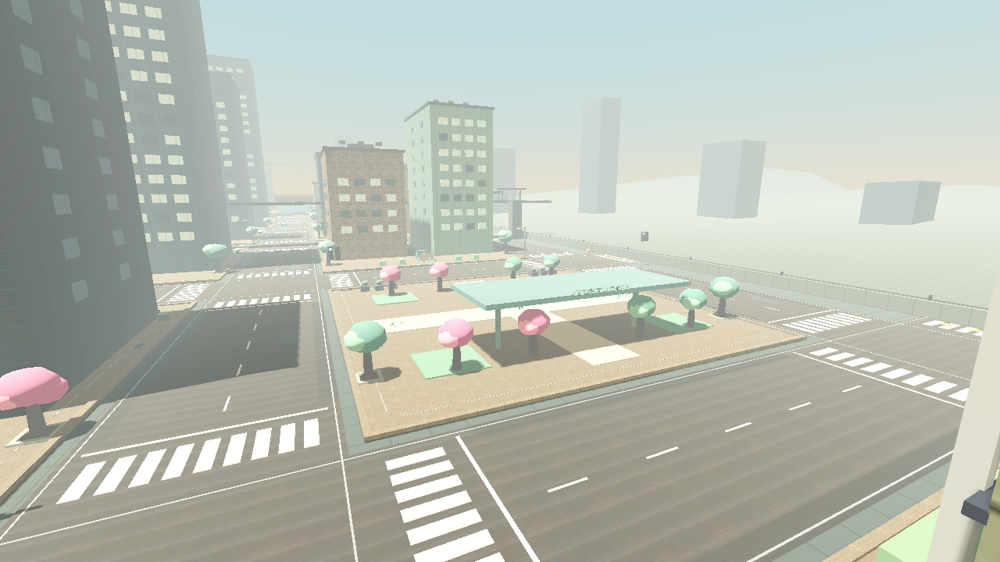
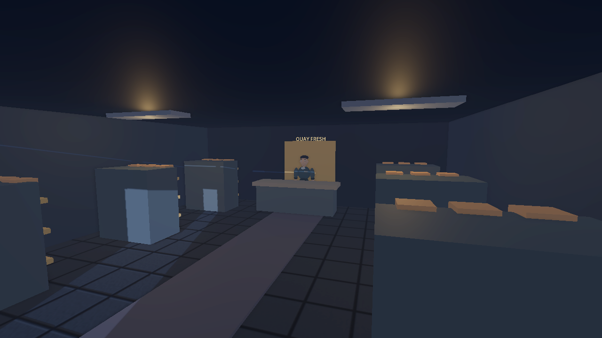
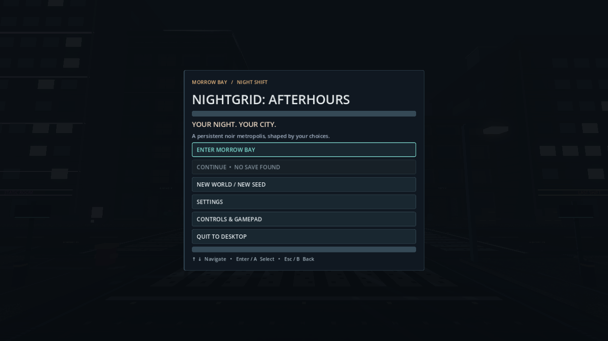
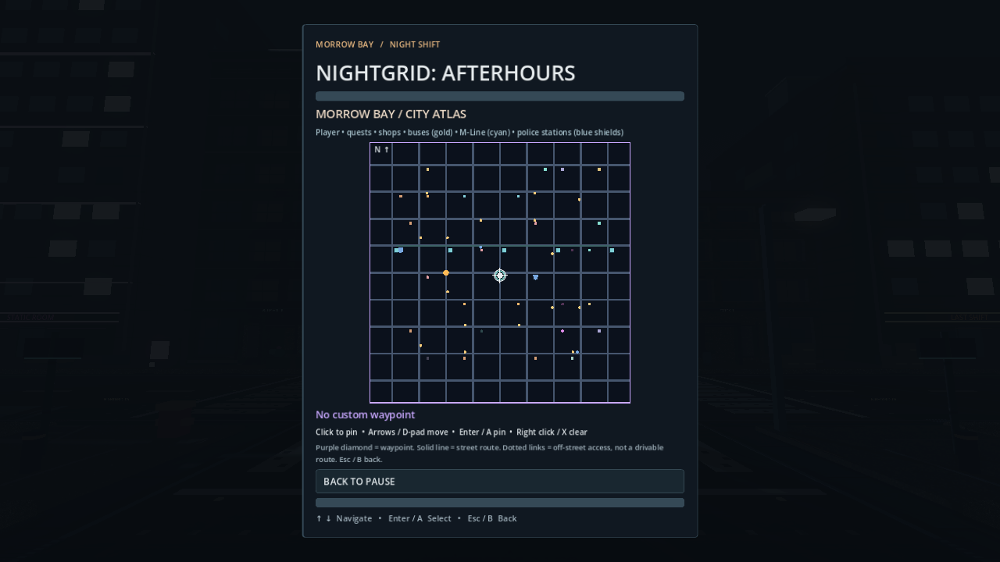
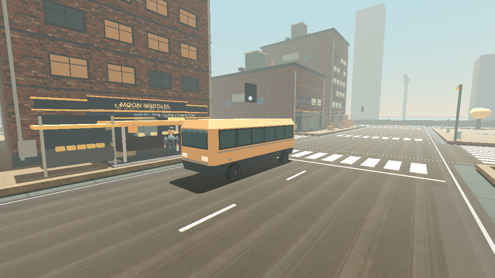
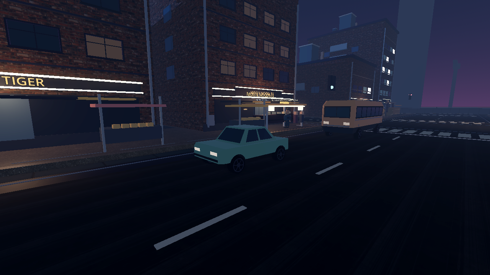

# Historical road and wheel comparison

Original Godot framebuffer captures from [PR #122](https://github.com/ProhibitedTV/NightGrid-Afterhours/pull/122), archive commit `e6f84683f6ee3bfa38befdbeb6fd12b989a014eb`, rendered source `0b1ead821cc46d6db6fe76bf4874737b6d7b8f5a`. Godot 4.7.2 Mesa software OpenGL Compatibility 1280x720 (NOT Vulkan/RTX). Nine source blobs preserved unchanged; all file sizes match the manifest and its recorded hashes are distinct. Compare the [original nine-frame baseline](https://github.com/ProhibitedTV/NightGrid-Afterhours/tree/8b4a502d87591675d20d44d9b6bfb4961084af73/docs/screenshots). This is historical evidence, not a current-main or native performance claim. The current road winding implementation and the later MultiMesh wheel port (#115) are already in main. Native visual review of the integrated build remains pending.

[Manifest](capture-manifest.json) · [Screenshot index](../README.md)

## morrow bay neon night

## vesper market nightlife

## m line helix terminal

## horizon commons daylight

## quay fresh interior

## title menu

## city map menu

## city bus coachwork

## civilian sedan coachwork

