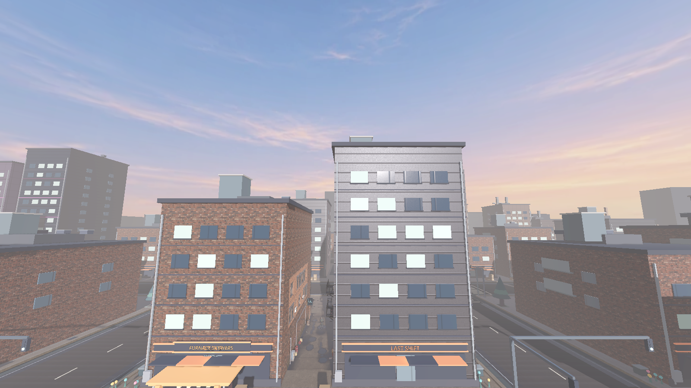
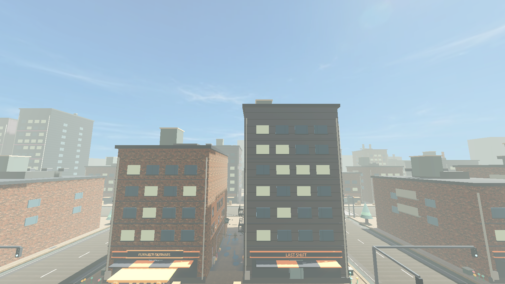
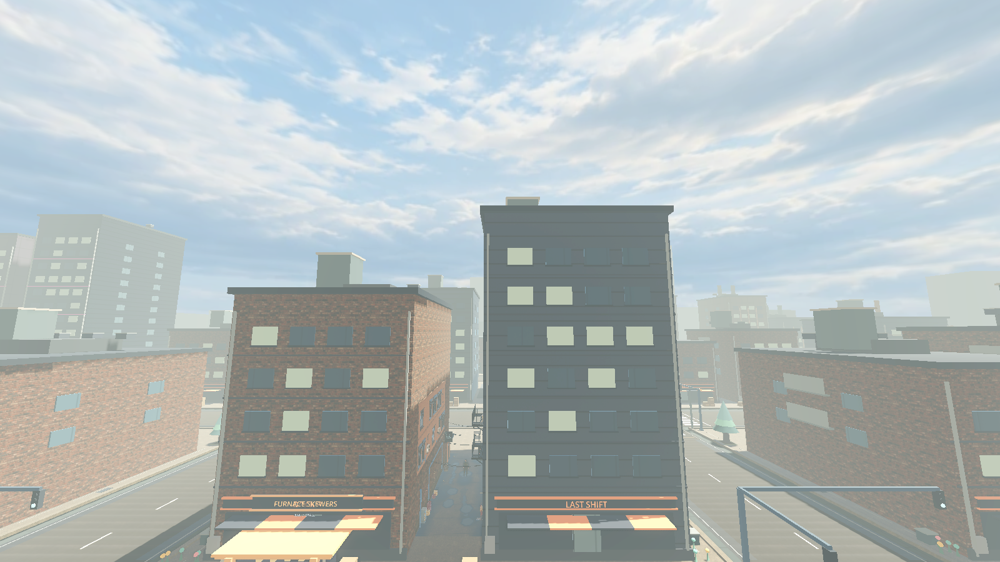
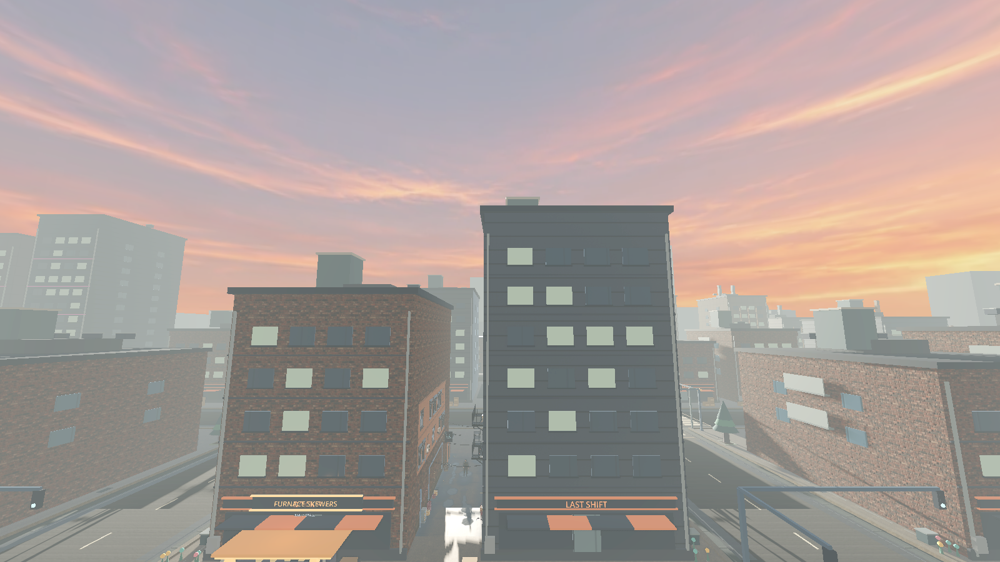
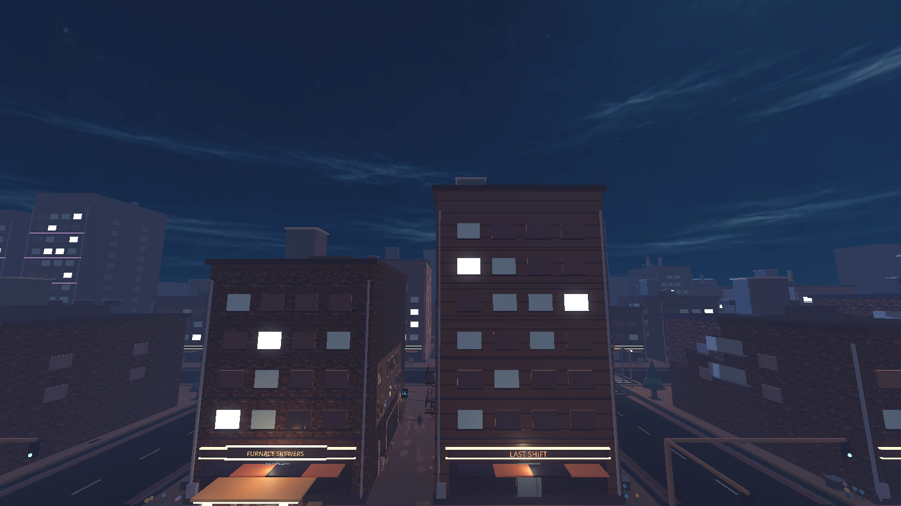
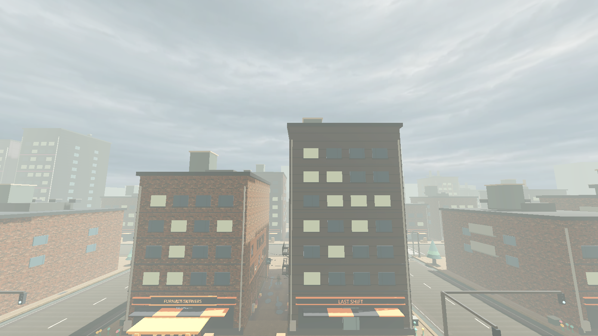
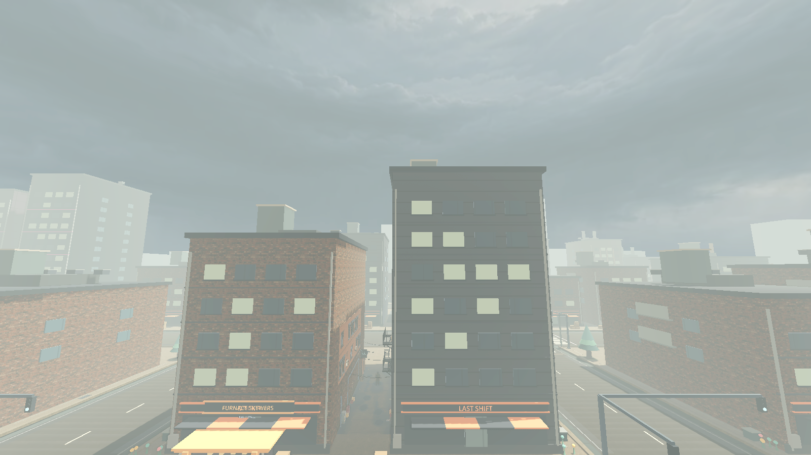
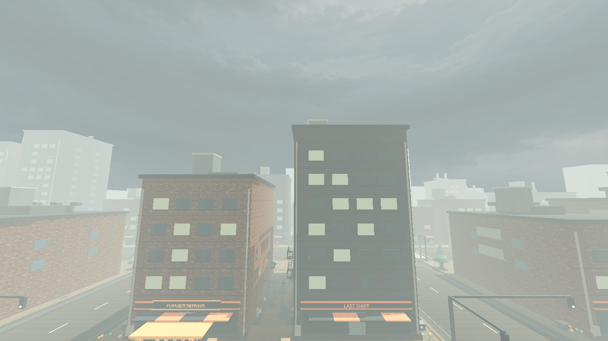

# Morrow Bay — original skyboxes in the real game

Eight **actual Godot framebuffer screenshots** of the same Brickwater viewpoint with different sky/weather presets. These are not concept renders, pasted panorama files or AI-generated mockups of the game. Camera framing and city geometry remain fixed; only the game clock and sky-weather preview change.

| Dawn · clear sky | Afternoon · sunny |
|:--:|:--:|
|  |  |
| **Afternoon · cloudy** | **Golden evening** |
|  |  |
| **Clear night** | **Overcast** |
|  |  |
| **Rain · sky/fog preview** | **Storm · sky/fog preview** |
|  |  |

**Captured game revision:** `2500ceb266e2dd0e2c75af159d627752b4f746f6` · all eight 1600×900 screenshots validated by [GitHub Actions](https://github.com/ProhibitedTV/NightGrid-Afterhours/actions/runs/45128895106) · capture-only 32px sky radiance cache for the software renderer; the full gameplay sky textures and source rendering settings are unmodified.

**Rendering provenance:** [Per-frame source, camera, Godot renderer and SHA256 hashes](capture.json). Captured using the *actual playable scene* in Godot 4.7.2 with an X11/Mesa OpenGL Compatibility renderer at 1600×900. These are genuine game pixels, but **not Windows Forward+/Vulkan RTX 3060 screenshots**; quality and atmospheric effects may differ on that renderer. The pilot's rain and storm presets adjust sky, sunlight and fog, without physical rainfall, lightning or persistence yet. Sky art originates from the eight original NightGrid panoramas integrated in [PR #207](https://github.com/ProhibitedTV/NightGrid-Afterhours/pull/207).

[Back to NightGrid](../../../README.md) · [Original Beta.8 gameplay capture archive](../beta8-rc1/GALLERY.md)
